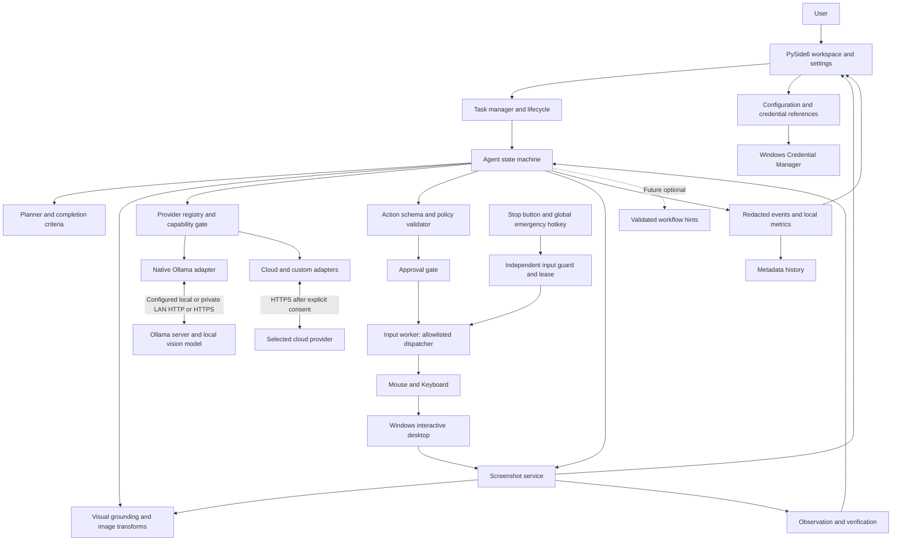
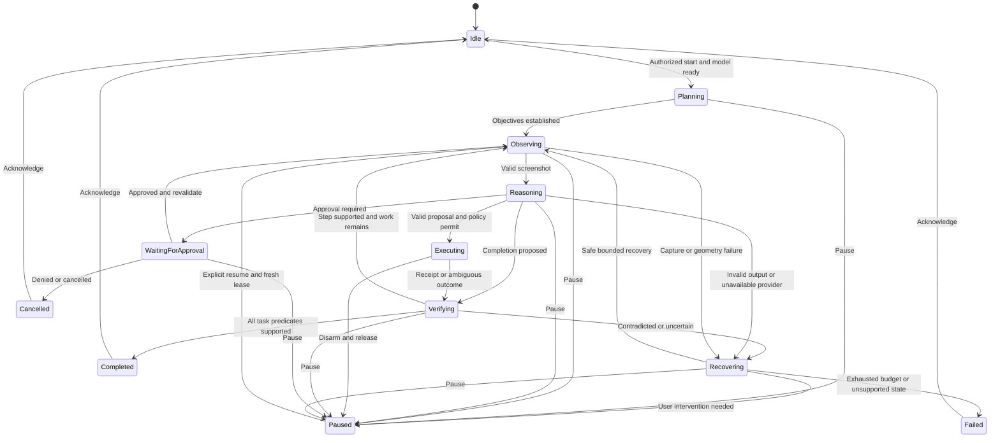

# Monster: architecture and implementation plan

**Status:** Proposed; review before implementation. **Prepared:** November 5, 2026 (America/Chicago).

This document specifies a Windows desktop product that operates target applications exclusively through **Screenshot, Mouse, and Keyboard**. It is a plan, not an implementation or a claim of demonstrated model accuracy. No application code or dependencies were added during this task.

## 1. Product understanding and scope

Monster accepts a natural-language objective, establishes visible completion criteria, observes the desktop, asks the selected vision model for a bounded next decision, validates that decision, executes input, and checks the resulting screen. The user sees the active objective, actual observations, actions, verification outcomes, and controls to interrupt execution.

The long-term ambition is broad computer use. The first release supports a deliberately small, measured operating envelope: Windows 11 x64, an unlocked interactive user session, standard-privilege applications, one selected display per task, and non-sensitive test data. The screenshot service enumerates all displays and can capture the full virtual desktop; cross-display task execution is deferred until mixed-DPI qualification. Windows 10, ARM64, remote desktop, games, protected video, elevated windows, and secure desktops are not initial supported targets.

### MVP scenarios

| Scenario | Visible completion contract |
| --- | --- |
| A: LAN Ollama | User enters endpoint, tests connection, discovers models, selects a vision model, and passes a synthetic image/schema probe. No desktop screenshot is sent during initial connection testing. |
| B: Notepad | Open through visible Start/search interaction, confirm an editor is present, type a paragraph, and verify the paragraph is visible. Do not require saving a file. |
| C: Chrome | Open through visible interaction, locate/focus the address bar, submit a search, and verify a results page corresponds to the query. This verifies search execution, not the truth or freshness of every result. |
| D: Provider switch | Pause, select a configured compatible cloud model, explicitly authorize screenshot transmission, discard pending decisions, observe again, and continue with the same engine and tools. |
| E: Recovery | Detect an injected harmless dialog or moved window, reobserve and recover within budget, or stop with an accurate intervention request. |

### Hard boundaries

- No target-application API, DOM, accessibility tree, application database, clipboard access, shell tool, or model-generated code execution. Browser navigation uses visible mouse/keyboard interaction.
- Typing commands into PowerShell, CMD, terminal windows, developer consoles, or the Run dialog must not become an indirect shell-execution bypass. For opening apps use Start search with an application name; no command strings or scripts.
- Win32 APIs for input, display geometry, emergency-stop registration, session state, and Monster's own window management are infrastructure, not a source of target UI semantics. Do not read target window titles, text, control trees, or documents to solve tasks.
- No background unattended operation, credential entry, purchases, money movement, installation, or administrative workflows in the MVP. Sensitive actions are approval-gated where supported and explicitly refused where outside scope.
- No automatic workflow learning in the MVP. No silent cloud fallback or model download.

### Assumptions and open decisions

Assume Chrome and Notepad are installed, the user provides an Ollama server with a suitable installed model, and development has access to a Windows test machine. This cloud checkout is Linux and cannot qualify Windows input/capture behavior. No LAN endpoint, GPU configuration, model tag, or API credential has been supplied, and none is needed to finish this plan.

Before release, confirm supported keyboard locales/IME behavior, enterprise distribution/signing requirements, exact GPU/model budget, and whether commercial licensing obligations favor LGPL compliance or a commercial Qt license. Proceed initially with US-English shortcuts plus separately tested Unicode text. Model size and quantization are benchmark selections, not architectural constants. Full multi-monitor action support and Windows ARM64 are later scope decisions.

## 2. Technology recommendation and alternatives

**Choose Python 3.12, PySide6, an explicit asynchronous state machine, native Ollama HTTP, and a narrowly scoped Windows input worker.** Pin exact supported versions and hashes during the first implementation milestone, after Windows compatibility checks. Do not infer install requirements from this planning document alone.

| Concern | Selection | Reason and limits |
| --- | --- | --- |
| Desktop UI | PySide6 Qt Widgets with restrained custom styling | One language; mature desktop layouts, accessibility for Monster's UI, tray and keyboard controls. Prefer readable workspace over a web dashboard. Qt licensing and deployment size need review. |
| Orchestration | Python `asyncio` in an engine thread; Qt signals for events | Explicit state transitions, cancellation, deterministic tests. Keep the Qt main thread free. No agent framework required. |
| Schemas | Pydantic v2 plus exported JSON Schema | Strict discriminated unions and provider schema adaptation. Parsing success never establishes semantic safety. |
| Capture | `mss` behind a Windows capture adapter; Pillow for bounded transforms | Practical full-display capture and image processing. Validate GDI capture behavior on supported machines; black/protected captures fail closed. Desktop Duplication/Windows Graphics Capture is a future backend if measured need justifies it. |
| Input | Small reviewed Win32 `SendInput` wrapper through `ctypes`; `pywin32` for supporting Windows integration where useful | Physical coordinates, Unicode input, explicit insertion counts and release control. More Windows code than PyAutoGUI, but avoids its primary-display and text-input assumptions. |
| Model transport | `httpx.AsyncClient`, native provider adapters | Common cancellation, deadlines, TLS, bounded responses. Provider SDKs may be added inside adapters where maintenance savings outweigh dependency cost. |
| Configuration | Versioned JSON validated by schemas; `platformdirs` paths | No credentials in JSON; atomic writes, migrations, restrictive user ACLs, safe defaults. |
| Secrets | Windows Credential Manager through Windows `keyring` backend | Store credential references only in configuration. Verify backend and fail if unavailable; never fall back to plaintext keyring. |
| Storage | SQLite for non-sensitive task metadata; RAM for current images/content | Built-in transactions and bounded history. Avoid an ORM initially. Content persistence is opt-in. |
| Logging | Standard logging with structured JSON, allowlisted fields and rotating files | Central redaction and bounded retention; no raw request logging. Metrics are local by default. |
| Tests | pytest, pytest-asyncio, Hypothesis for geometry/schema properties, pytest-qt | Deterministic replay plus real Windows GUI tests; no provider costs in default CI. |
| Tooling | uv lockfile, Ruff, mypy, GitHub Actions including Windows | Reproducible dependencies and platform-specific checks when implementation begins. |
| Packaging | PyInstaller on Windows, initially a one-folder build; signed installer later | Straightforward Python/Qt packaging and easier diagnostics than one-file extraction. Validate clean-machine install, upgrades, and signing before distribution. |

### Desktop alternatives

| Alternative | Advantages | Why not initial choice |
| --- | --- | --- |
| Python + PySide6 | Fast vertical integration, native desktop facilities, no local web server | Selected; larger bundle and Qt obligations are accepted costs. |
| Tauri + React + Python sidecar | Rich web UI, Rust shell, possible smaller frontend | Adds Rust/JS/Python builds, IPC, sidecar lifecycle and WebView2 requirements before control reliability is proven. Revisit if product UI requirements warrant migration. |
| Electron/React + Python | Familiar frontend ecosystem and flexible rendering | Larger footprint plus two runtimes and a local interface security surface. |
| C#/.NET + WPF | Excellent Windows integration and deployment story | Credible second choice; splits model experimentation and control/UI work across languages if Python remains. Prefer for a team already strongly invested in .NET. |

Use ports/adapters for providers and computer tools, a single-writer task state machine, immutable event records, and dependency injection through ordinary constructors. Do not introduce a plugin marketplace, event broker, multi-agent planner, vector database, or distributed service architecture for the MVP.

## 3. High-level system architecture



### Component responsibilities and boundaries

| Component | Responsibility and contract |
| --- | --- |
| Desktop UI | Task input, model/location indicator, screenshot preview, action marker, timeline, approval cards and always-visible Stop. Sends lifecycle requests; cannot directly inject input. |
| Task management | One active task/input owner, task IDs, budgets, deadlines, summaries, and lifecycle state. Queued tasks require a fresh start authorization. |
| Agent engine | Sequences observation, inference, policy, execution and verification; owns task generation and cancellation token. Never calls native input outside the dispatcher. |
| Planner | Produces short objectives and explicit completion predicates. Revises objectives from evidence, not a queued list of coordinates. |
| Provider registry | Instantiates adapters by kind, checks compatibility, owns model descriptors and runtime configuration generations. |
| Ollama adapter | Native discovery, metadata, probes, inference, timeout classification and local-only routing checks. |
| Cloud adapters | Translate provider authentication, multimodal content, structured outputs, rate limits, refusals and usage into shared results. |
| Visual grounding | Selects views/crops, maps model coordinates, tracks transforms and uncertainty. It does not execute input. |
| Computer control | Screenshot service plus Mouse/Keyboard worker. Exposes exactly the three application-interaction categories. |
| Action validation/execution | Strict parsing, operation allowlist, bounds, freshness, policy and approval checking; serial dispatch and execution receipts. |
| Observation/verification | Acquires post-action evidence, checks expected visual predicates, detects uncertainty and triggers recovery. A model's final message alone cannot complete a task. |
| Safety/approval | Authoritative policy, one-time approvals, independent stop path, duration/action limits, and denial decisions. Model risk suggestions can only increase review. |
| Configuration/credentials | Versioned preferences and provider endpoints; secret references resolved only by transport. Endpoint changes require consent again. |
| Logging/telemetry | Content-free events, timing and outcome metrics; no hidden chain-of-thought collection. |
| Future workflow memory | Optional consented semantic procedures, prerequisites and verification hints, versioned with provenance. Never authoritative instructions or permanent screen coordinates. |

### Runtime arrangement

One desktop application process contains Qt and a dedicated engine thread running an asyncio loop. A separate local input worker receives strict framed messages over an ACL-restricted Windows named pipe, with a per-session handshake and no network listener. Only that worker may call input APIs. It has no model credentials, no model transport, no `eval`/`exec`, and no arbitrary operation or file path dispatch.

The worker owns an independent message pump for emergency hotkey registration, an input lease watchdog, and a serial execution queue. An initial candidate hotkey is Ctrl+Alt+Shift+F12; registration failure blocks arming until the user selects a working combination. The model cannot unregister it. Worker process separation is a reliability boundary, not an OS security sandbox against malicious local software.

The engine renews a short input lease while active. Stop, lost heartbeat, session lock, invalid IPC, or desktop/display changes disarm the worker and invalidate queued commands. A model request never holds an input lock. Commands carry task generation, observation ID, sequence ID and deadline; late results cannot reactivate input. The worker checks its armed lease immediately before each input chunk and during drags/typing. No background service or elevation is required.

## 4. Agent execution strategy and sequence

Choose a small hierarchical plan with a **closed-loop next-action controller**. ReAct-style observation and action feedback are useful; do not store or display private model reasoning. Show short decision summaries and evidence instead. A fixed plan-and-execute script fails on moving windows; an elaborate autonomous planner adds little until one-step grounding works.

Default to one meaningful action per decision. A hotkey chord, double click, bounded text entry, or drag is one bounded input transaction. Do not batch navigation across unobserved states. Every meaningful transaction has a new screenshot and visual verification before proceeding.

```mermaid
sequenceDiagram
    actor User
    participant UI as Workspace
    participant C as Agent controller
    participant S as Screenshot service
    participant P as Model provider
    participant G as Policy and input executor
    participant W as Windows desktop
    participant V as Verifier
    User->>UI: Open Notepad and write a paragraph
    UI->>C: Start with selected model and consent
    C->>P: Plan objectives and visible completion criteria
    P-->>C: Open editor, enter text, verify
    C->>S: Capture selected display
    S->>W: Read visible pixels
    W-->>S: Frame and geometry
    S-->>C: Observation with transform and ID
    C->>P: Observation, objective, permitted decision schema
    P-->>C: Keyboard proposal to open Start
    C->>G: Validate and dispatch if authorized
    G->>W: Bounded key chord
    G-->>C: Input insertion receipt
    loop Search Notepad and open editor, one verified transaction at a time
        C->>S: Capture after bounded settling
        S->>W: Capture pixels
        W-->>S: New frame
        S-->>V: Post-action observation
        V->>P: Check expected visible result
        P-->>V: Supported, contradicted, or uncertain
        V-->>C: Evidence and next-state assessment
        C->>P: New observation and next objective
        P-->>C: Validated-schema next proposal
        C->>G: Policy and freshness checks
        G->>W: Mouse or Keyboard input
        G-->>C: Receipt
    end
    C->>S: Observe editor before text entry
    S-->>C: Fresh frame
    C->>P: Generate paragraph and text-entry proposal
    P-->>C: Text and expected visible result
    C->>G: Validate focus evidence and bounded text
    G->>W: Unicode typing in chunks
    G-->>C: Inserted input count, not task success
    C->>S: Capture final screen
    S-->>V: Final observation
    V->>P: Verify editor and requested paragraph are visible
    P-->>V: Evidence for completion predicates
    V-->>C: Pass or uncertain
    alt All completion predicates supported
        C-->>UI: Completed with concise summary
    else Insufficient evidence
        C-->>UI: Recovery or user intervention; no false completion
    end
    UI-->>User: Outcome, actions and verification summary
    Note over User,G: Stop disarms input independently at any point
```

### Evidence, recovery and budgets

Each step records proposed action, policy outcome, insertion receipt, post-observation, and verification outcome separately. Verification is `supported`, `contradicted`, or `uncertain`, with a short visible evidence description and frame reference. Image change is evidence of change, not evidence of success. An unchanged screen can still represent a successful focus operation.

Use a bounded local settling detector: capture a small number of frames and compare changes, with a maximum wait; do not equate stillness with readiness. Then request semantic verification. Prefer combining verification and the next proposal in one inference response, while permitting execution only if verification passed. Final completion gets a dedicated check against the original criteria. A second model pass is not independent ground truth; benchmark against human-reviewed GUI outcomes.

Proposed defaults, subject to measurement: 5-minute task deadline, 50 executed transactions, 100 model calls, 2 recovery attempts per objective, 5 recovery attempts total, and 2 schema repair attempts. Approval waiting permits no input and expires after 2 minutes; it does not silently extend the task deadline. Users may raise budgets before a task, not through screen content or model suggestions.

Detect loops using objective ID + semantic action fingerprint + perceptual observation similarity. Three repeated no-progress attempts stop the task; count retries across equivalent wording and coordinate jitter. Recovery reobserves, tries one materially different safe approach, or asks for intervention. Never replay a click or text entry after an ambiguous timeout: it may already have occurred. Inference retries may use jitter and Retry-After within a shared deadline, but duplicate provider charges remain possible.

Unexpected focus changes, user pointer/key activity, display topology changes, or lock/disconnect disarm input and pause/recover. Input hooks used to distinguish injected from physical activity collect only activity signals, not user key content; qualification must show this detection is reliable enough. Detection has races, so active tasks prominently warn that user activity pauses execution and always reobserve before resuming. UAC/secure-desktop, elevated target input rejection, and inaccessible capture require user intervention; never elevate automatically.

## 5. Provider integration specification

### Interfaces (contracts, not source code)

| Operation | Inputs | Output / behavior |
| --- | --- | --- |
| Register adapter | Stable provider kind and adapter factory | Registry entry; duplicate kinds rejected. Built-in adapters only initially. |
| Validate configuration | Endpoint, credential reference, supported settings | Validated immutable config or field errors. Reject URL credentials, unsupported schemes, unapproved redirects and endpoint paths. |
| Health check | Config, deadline, cancellation token | Reachable/authenticated/API-compatible flags, latency and safe error category. A reachable server does not prove vision works. |
| Discover models | Config, pagination/cancellation | Model descriptors; explicit configured IDs when listing is unavailable. Listing permission may differ from inference permission. |
| Describe capabilities | Provider, model revision, server version | Registry record with evidence provenance, limits and unknowns. |
| Probe | Synthetic image, schema, consented low-cost request | Verified image perception and schema behavior; no input execution. |
| Infer | Task context, immutable images, requested decision schema, limits | Normalized decision, usage, finish/refusal status, safe diagnostic ID and elapsed time. |
| Cancel/close | Request/session ID | Abort local wait, release transport resources, discard late responses. Server-side inference cancellation is best effort. |
| Resolve authentication | Credential reference scoped to endpoint | Transport-only credentials; never returned to planner or tool worker. |

The engine uses the same `InferenceRequest` and `AgentDecision` for every provider. Adapters translate content blocks, image encoding, JSON Schema subsets and error semantics. They cannot create input actions directly. A provider-native computer-use action can be accepted only if losslessly mapped into the three allowed categories with full validation; unsupported actions are rejected. Built-in browser, shell, search or code tools are never enabled for convenience.

### Capability registry

Key by provider kind, endpoint identity, model ID/revision/digest when available, server/API version and adapter version. Each capability has `supported`, `unsupported`, or `unknown`, a source (`metadata`, `provider documentation`, `probe`, `user configuration`) and observation time. Invalidate on model/endpoint/config changes and refresh stale records.

Track image input, text output, JSON/schema modes, tool calling, effective context limit, output limit, image count/byte/dimension limits, provider image resizing behavior, reasoning parameter support, rate limits, local/cloud routing and observed probe results. Preserve unknown numeric limits rather than inventing values. Effective context is the minimum of advertised, configured and tested settings; model architecture context size is not necessarily the server's allocated context. Vision token cost may be opaque.

A screenshot task requires proven image support and a passing schema/decision probe. Native schema enforcement is preferred. Where only textual JSON is available, parse strictly with bounded repair; enable execution only after compatibility testing. Tool calling is optional, not a requirement. A text-only or unresolved model remains available for settings, but Start explains the incompatibility. Never guess vision support solely from a model name.

### Ollama: native API first

Use `GET /api/version`, `GET /api/tags`, `POST /api/show`, and `POST /api/chat`. Send image bytes as base64 in message `images`, set `format` to the simplified decision JSON Schema, and initially use `stream: false`. Parse only the final completed message. Separate a returned reasoning/thinking field from the action payload and do not persist it. Use low temperature where supported; it does not make actions deterministic or correct.

`/api/show` supplies capabilities and model metadata on compatible servers. Older servers may omit these; mark unknown and run a controlled synthetic probe or report an unsupported version. Tags plus a name are not sufficient. Record model digest, quantization, runtime version, configured context, cold/warm latency, and probe results. No automatic pull/load of very large models; explicitly explain server RAM/VRAM and disk requirements before the user chooses such operations outside task execution.

The OpenAI-compatible API is useful for custom endpoints and common chat workflows, but is a documented subset and does not replace Ollama-native discovery/metadata. Keep a separate generic OpenAI-compatible adapter rather than making native Ollama depend on proprietary SDK semantics. Native Ollama is the primary implementation and test target.

Settings expose connect timeout (initially 5 seconds), total inference timeout (initially 120 seconds), bounded response size and selected model. These are proposed defaults, not latency guarantees. Local model cold loads can exceed them; show loading/timeout guidance and permit deliberate adjustment. Avoid background warmup that unexpectedly consumes server resources. Model switch cancels old inference, increments configuration generation, reruns capability checks and observes anew; it never consumes a response from the old model.

### LAN deployment and privacy

Ollama normally binds to loopback port 11434. To serve another computer, configure `OLLAMA_HOST` on the inference host to a private interface/address and restart Ollama using that host's documented service procedure. Binding `0.0.0.0` exposes every interface and must be paired with host firewall restrictions. Allow inbound TCP only from the agent machine on the intended private profile/subnet. No router port forwarding, public tunnel, or public Internet exposure is needed or recommended.

A plain local Ollama listener must not be treated as authenticated. A client SDK placeholder key does not secure it. Prefer HTTPS with certificate validation and authenticated reverse proxy for shared/untrusted LANs, or a properly administered private VPN. Never disable TLS verification. HTTP may be explicitly permitted for localhost or a trusted private LAN after disclosure that screenshots are unencrypted in transit. Validate actual endpoint identity and restrict redirects to prevent credential/image leakage.

**Local endpoint does not prove local inference.** Current Ollama can route cloud-backed models. For local-only mode, use installed local weights, inspect remote metadata where available, configure the server's documented cloud-disable option (`OLLAMA_NO_CLOUD=1` in the inspected version), and verify server deployment. Monster cannot attest a remote server's internals; label the operator-declared trust boundary honestly. Reject known cloud-backed models in local-only mode. Network retries must never change destination or choose a cloud provider.

### Provider differences

These are adapter design requirements; live compatibility with specific model IDs has not been tested in this task. At implementation time pin API versions and validate the chosen model against current official documentation and a real consented request.

| Provider | Adapter responsibilities |
| --- | --- |
| OpenAI | Responses API text/image content, model-specific structured output support, refusals/incomplete results, usage and optional reasoning controls. Disable built-in computer/browser/code tools. Avoid hidden state dependence; manage bounded context in the engine. |
| Gemini | Native generate-content API, inline image parts, model discovery where available, schema/MIME controls, safety-block and candidate finish states. Handle differences in supported schema vocabulary and quotas. |
| Anthropic | Messages API image blocks, API version header, tool-use/schema strategy per supported model, stop reasons and token limits. Do not assume native computer-use schemas or coordinates match Monster's. |
| OpenRouter | OpenAI-style transport plus model/provider routing metadata. Show selected route and data destinations; disallow unapproved backend fallback. Listing vision metadata is a hint until probed. |
| Groq | OpenAI-style chat with model-dependent vision and structured-output support. Require an actually available image-capable model; do not promise screenshot support across its catalog. |
| Custom compatible | Explicit base URL, auth configuration and user model IDs. Probe image/schema/limits; “OpenAI-compatible” is not evidence of Responses API or schema parity. |
| Ollama | Native tags/show/chat and local/LAN trust status as above. No API key needed for a plain local listener; optional proxy auth is a separate endpoint configuration. |

Normalize transport failures into unavailable, DNS/connect failure, authentication, authorization, rate-limit, timeout, context-too-large, unsupported capability, refused, malformed output, or cancelled. Expose actionable messages without raw bodies that might include secrets or screenshot content. Only transient categories are retryable. Context-too-large triggers a smaller current view/history, never silent deletion of policy or task criteria.

### Model candidates and qualification

Qwen3-VL is a serious open-weight candidate because it supports visual understanding and is represented in the inspected Ollama runtime. That is not evidence of reliable GUI grounding. Compare a hardware-feasible Qwen3-VL variant/quantization with another installed vision family such as Qwen2.5-VL or a suitable Gemma vision model, and optionally a consented cloud baseline. Availability, licenses and hardware requirements depend on exact releases; verify before bundling or distributing weights. Monster initially distributes no weights.

Measure target-hit rate on screenshots with labeled bounding boxes, text transcription errors, ambiguity detection, schema validity, false completion and latency at 100/150/200% scaling. Use held-out layouts, small icons, long paragraphs, compressed views and distractor dialogs. Quantization may reduce grounding quality. Select based on measured Notepad/browser performance on the user's GPU, not parameter count or marketing benchmark. If no local model passes, report the limitation; changing to cloud requires an explicit choice.

## 6. Three computer-tool contracts and action protocol

### Shared envelope

Every tool request has protocol version, task ID, monotonic task/config generation, unique action ID, sequence number, deadline, and cancellation linkage. Input additionally requires observation/view ID, geometry epoch, expected visible result, target description, and a one-time policy authorization. Strict schemas reject unknown fields, wrong types, NaN/infinity, excessive lengths and invalid enum values. The worker independently validates physical input bounds and lease validity.

A model returns an `AgentDecision` discriminated union: propose one Screenshot/Mouse/Keyboard operation; request clarification; report inability; or propose completion with predicate evidence. Lifecycle and clarification are engine decisions, not additional computer tools. Waiting is an internal bounded scheduler operation, never a shell or delay program.

Proposals include short purpose, expected result, uncertainty and model-suggested risk. Confidence is uncalibrated unless measured and cannot authorize input. The model cannot set authoritative `approved=true`; policy computes approval status and creates a separate authorization token. Tokens bind task/action digest, observation, destination/provider, scope and expiry, and cannot be reused after changes.

### Screenshot

| Field | Contract |
| --- | --- |
| Request | Capture selected display ID or full virtual desktop; optional bounded crop in physical pixels relative to the selected capture; requested maximum dimensions and PNG/JPEG encoding. |
| Result | Observation ID, monotonic capture time, display IDs/physical bounds, geometry epoch, image bytes held by opaque local reference, encoded dimensions, source rectangle, scaling/padding transform and hash. No arbitrary output path or URL from the model. |
| Validation | Known displays, positive dimensions, in-bounds crop, supported encoding, maximum pixel/byte budget; reject capture spanning unapproved displays. Full-desktop capture requires scope consent. |
| Errors | Session locked, capture unavailable/protected, stale topology, invalid crop, too large, cancelled. Black or implausible frames trigger intervention, not coordinate guessing. |

Cropping/resizing are internal Screenshot operations, not a fourth tool. Capture full native resolution locally; submit a bounded overview and optional detailed crop. Keep display origin and transform immutable for each observation. Do not send every preview refresh to inference.

### Coordinate grounding

Canonical executor coordinates are physical virtual-desktop pixels, including negative monitor origins. Establish Per-Monitor DPI Awareness V2 before creating windows/capture objects. Avoid applying DPI scaling twice: capture pixel dimensions and display physical rectangles define the map; DPI remains diagnostic metadata.

The model proposes coordinates in the exact submitted view's pixel space. For source crop origin `(cx, cy)` within display `(ox, oy)`, content scale `(sx, sy)` and padding `(px, py)`, invert preprocessing:

`desktop_x = ox + cx + (view_x - px) / sx`

`desktop_y = oy + cy + (view_y - py) / sy`

Reject padding/out-of-view coordinates before rounding. Each adapter must convert any native normalized coordinate convention into view pixels, with explicit inclusive/exclusive endpoints. Retain the original view for reproducibility. Convert physical coordinates to Windows absolute input over the full virtual desktop using `MOUSEEVENTF_ABSOLUTE | MOUSEEVENTF_VIRTUALDESK`; use the tested `(dimension - 1)` endpoint mapping and clamp only floating-point rounding, never an out-of-bounds model action.

Example test fixture: display origin `(-1920,0)`, crop origin `(400,200)`, crop `800x600` resized to `400x300`, no padding. Model point `(100,50)` maps to desktop `(-1320,300)`. Property tests cover inverse transforms and corners. A monitor move/resolution/DPI change increments geometry epoch and invalidates all pending coordinates.

When a target is small or ambiguous, ask for a labeled crop and re-ground. Do not magnify a thumbnail and assume missing detail reappears. Display predicted click markers in Monster's preview, never feed those markers back as original evidence. Reobserve after long inference (initial freshness threshold 2 seconds for dispatch) and compare relevant screen regions before permitting an older decision. If a scene remains stable, a new frame can explicitly revalidate that decision; otherwise regenerate it. A stable image is still not proof of unchanged application semantics.

### Mouse

| Field | Contract |
| --- | --- |
| Operations | Move, click, double-click, right-click, vertical/horizontal wheel, drag, down, up. |
| Parameters | Finite view coordinate(s), display/view ID, button enum, bounded wheel delta with explicit Windows wheel units, bounded duration and drag path. Scroll requires known pointer target or an explicit move first. |
| Validation | Fresh view and geometry; authorized display; bounded speed/duration; valid button state; one active input owner. No arbitrary trajectories or infinite holding. |
| Result | Action ID, insertion count, start/end times, final pointer position where available, executed/partial/rejected/unknown state and error code. This is not an application success result. |
| Failure behavior | Stop immediately on partial insertion; release owned buttons; observe before any retry. Horizontal wheel support is best effort and must be visually verified. |

Prefer atomic drag with guaranteed release. Explicit down/up exists for completeness but a held button gets a short watchdog timeout (initially 2 seconds); extend only via bounded validated drag handling. Every cancellation/failure attempts release of worker-owned inputs. Do not globally release the user's physical keys indiscriminately.

### Keyboard

| Field | Contract |
| --- | --- |
| Operations | Type Unicode text, press allowlisted named key, bounded chord, explicit modifier down/up with lease. |
| Parameters | Text with length cap (initially 2,000 Unicode code points per transaction), key enums, modifier list, bounded repetitions/hold duration. Text and key fields are mutually exclusive. |
| Implementation | `SendInput` Unicode events with correct UTF-16 handling; tested scan/virtual-key handling for shortcuts and extended keys. Chunk text so stop is checked frequently (target 20–50 ms between checks). No clipboard paste shortcut. |
| Validation | Fresh screenshot evidence of intended editable focus, no protected/credential/admin or terminal context, safe chord policy, budget and approval checks. No arbitrary virtual-key integers from the model. |
| Result | Inserted event count and partial/unknown classification; typed content excluded from routine logs. Reobserve to verify visible text. |
| Errors | Input rejected/UIPI, lost focus, unsupported IME behavior, invalid key, cancellation, partial input. Do not retry the whole paragraph blindly. |

Unicode input is not universal compatibility: IMEs, surrogate pairs, applications and shortcuts require Windows tests. Password fields may not be reliably recognizable visually, so credential handling remains unsupported. `SendInput` success only means Windows accepted events; UIPI can block higher-integrity targets and target apps may ignore events.

### Execution pipeline

1. Adapter normalizes a complete response; never execute partial streamed tokens.
2. Parse strict decision schema; repair malformed output within budget without input.
3. Ground coordinates using the referenced immutable view.
4. Revalidate scene, scope, policy, freshness and current task generation.
5. Ask the user when required; reobserve and revalidate after approval.
6. Send a bounded command with one-time authorization to the armed worker.
7. Worker serializes and deduplicates action IDs, checks lease, inserts events and issues a receipt.
8. Capture and verify visible outcome. Duplicate receipt lookup does not replay input; after crash or uncertain acknowledgment treat outcome as unknown and observe.

## 7. Task lifecycle state machine



The diagram shows normal paths; these global rules complete it:

- From every nonterminal active state, Cancel or emergency Stop immediately disarms input, invalidates the generation and enters Cancelled after recording cleanup outcome. Stop is terminal for that run; Resume cannot restart it.
- From any active state, task deadline/budget exhaustion enters Failed after disarming. Policy violations and unrecoverable platform errors also fail. Worker crash fails rather than resuming unknown queued actions.
- Pause cancels/discards pending inference and input, releases owned keys/buttons, and retains a semantic checkpoint only. Resume always returns to Observing, never directly to Executing. The task deadline continues while paused; a longer task requires a new explicit run.
- Approval denial cancels the proposed run; an alternative requires user direction/new task. Approval expiry disarms and enters Paused if task time remains, otherwise Failed. Screen/config changes invalidate approval.
- Terminal states accept no action results except diagnostic/cleanup events. Start creates a new task ID, never resets a terminal record.
- Lifecycle transition checks use one serialized reducer. Worker lease enforcement remains independent of reducer/thread/model health. If cleanup cannot be confirmed, show a persistent warning and block rearming pending explicit recovery.

## 8. Desktop experience, security and privacy

### Workspace layout

Use a compact top strip for task status, selected model and processing location, with Pause and a prominent Stop. Below, place a task instruction/completion panel beside the latest observed desktop view. A chronological timeline shows objective, proposed action, execution receipt and verification outcome. Distinguish the captured observation time from live desktop state; a thumbnail is never labeled live when stale.

Show a collapsed history drawer for outcome metadata and an explicit content-retention opt-in. Model settings provide provider CRUD, masked credential entry, endpoint testing, installed/configured models, capability badges (`verified`, `unsupported`, `unknown`), timeout options and useful errors. Screenshot settings include selected display, preview frequency, cloud transmission consent, crop/masking preferences and retention. Never include key values in screenshots/exported settings; mask by default and avoid “show key” in the MVP.

Reuse existing captures for preview and throttle UI rendering (initial maximum 2 Hz, independent of inference). Keep Monster's settings/credential view out of captures: disable tasks during credential editing, collapse its panel before acting, and test supported capture-exclusion behavior for its own windows. If capture exclusion fails, pause until sensitive settings are closed. Overlay previews stay within Monster's UI. The agent must not control its own approval or Stop controls.

### Policy and approvals

| Intent/context | MVP policy |
| --- | --- |
| Open installed ordinary app through Start; benign typing/search | Allowed within user task scope after visual context checks. |
| Send email/message, submit external form, share document | Prepare if in scope; one-time approval of concrete recipient/content/action before sending. If recipient/content cannot be visually established, refuse dispatch and request manual action. |
| Delete/overwrite files, install, change settings | Outside initial supported workflows; stop for manual intervention. Later releases need specific previews and approvals, not broad “allow everything.” |
| Purchase, transfer, credential entry, UAC/elevation | Unsupported MVP; manual user action. |
| Unknown context, terminal, unexpected executable prompt | No automated input; ask for intervention. |

Visual policy enforcement is probabilistic. A valid mouse click can still hit a harmful button, and an Enter key can submit a form. Therefore combine restricted task scope, visible context checks, intent classification, conservative ambiguity handling, one-action execution and controlled environments. This is not a guarantee that arbitrary real-world tasks are safe. Do not advertise a secure autonomous agent for sensitive accounts based on schema validation alone.

Approval UI shows the current screenshot crop, intended target, action/payload summary, recipient/destination where relevant, and consequences. Render all observed strings as inert text. Bind approval to the concrete proposal, expire it, and recheck the screen before acting. The model cannot click an approval card or submit a lifecycle command. Avoid training the user to approve unexplained coordinates.

### Prompt injection defenses

Treat screenshots, extracted visual text and workflow memory as untrusted observations. Preserve a separate trusted user task and immutable policy in inference requests. Delimit observation data and instruct the model to report malicious instructions rather than follow them, but do not rely on prompting alone. No observation can change provider, budgets, tool permissions, credentials or approval status. Reject proposed task drift, terminal commands, secret requests and unsupported tools outside the model. In uncertain cases stop.

Adversarial tests include fake system messages in email/web content, instructions to send data elsewhere, approval-looking graphics, disguised downloads, and screenshots containing API-key requests. Separate semantic safety classification can help but shares model failure modes. A second model is optional defense-in-depth, not a trusted authority.

### Data handling

- Default: screenshots and task content in bounded process memory only. No persistent prompt, paragraph, keystroke payload, raw provider response, or hidden reasoning history. Clear references at task end; do not promise forensic memory erasure or protection from OS paging/crash dumps.
- Persist only task IDs, timestamps, provider/model identifiers, action categories, durations, safe error codes, verification status and aggregate counts. Even metadata can be sensitive; configurable retention with a proposed 7-day default and Clear History.
- Optional debug sessions require explicit consent, user-scoped storage ACLs, at-rest protection appropriate to Windows, content warnings, short retention and explicit export. Never bundle debug files automatically with crash reports.
- Credential resolution is transport-only. Redact request headers, URL query credentials, provider error bodies and config diagnostics. Store keys under per-provider references; removal deletes the selected reference without affecting others.
- Screenshot transmission consent specifies endpoint and selected provider. Cloud/router routing, provider retention and account terms must be disclosed. Local/LAN does not imply no exposure to other users on the inference server.
- Optional user-defined masks are applied before any network transmission. Automatic sensitive-region detection cannot guarantee secrecy. If masking hides a required target, pause rather than infer around it.
- Clear local retention does not delete data already received by providers or guarantee secure deletion from SSDs/backups. Remote deletion follows provider policies.

## 9. Performance, metrics and future memory

Instrument capture, resize/encode, upload, queue/cold load, inference, validation, approval wait, input, settling and verification separately. Use monotonic timing and correlate safe IDs without content. Report p50/p95 and separate cold/warm inference and model/hardware configurations. Avoid presenting a single average as a universal latency promise.

| Metric | Definition |
| --- | --- |
| Task completion | Human-verified successful tasks / all attempted tasks; report cancelled, failed and unsupported separately, including denominators. |
| Action success | Visually supported outcomes / attempted input transactions, separated from Windows insertion success. |
| Grounding accuracy | Labeled target hits / eligible predictions, with layout/DPI breakdown and uncertainty rate. |
| False completion | Reported completed tasks whose visible outcome fails the task rubric. |
| Model latency | Request-to-complete distribution, with provider/server/model and cold/warm split. |
| Cost and efficiency | Model calls, tokens where reported, transmitted bytes and estimated cost with source/date; unknown cost stays unknown. |
| Recovery/intervention | Attempts, recovered objectives, user intervention rate and stop responsiveness. |

Start with one overview and a current crop when needed; do not repeatedly resend an ever-growing screenshot transcript. Keep trusted task/criteria, a compact evidence summary, and a bounded recent observation window. Never remove safety policy to fit context. Local image hashes prevent identical UI redraw work but do not establish task readiness. Do not reuse a stale inference result solely because the image is similar.

Optimize only after correctness baselines: merge verification/next decision, tune image resolution against target-hit rate, cache model metadata, and throttle monitoring. Aggressive multi-action batching, speculative clicks and skipping verification are deferred.

Future memory stores semantic steps such as “locate the search field, enter the query, verify result heading,” with prerequisites, expected UI evidence, application version hints and user approval. Store provenance and expiration, encrypt sensitive opt-in content, and provide inspect/delete controls. A remembered procedure proposes hypotheses; current screenshots and policy must validate every step. No persistent absolute coordinates, inferred credentials, or silent learning from private email.

## 10. Reference project review and reuse

### Verified inspection

Inspected `openai/openai-cua-sample-app` at commit **6dd34b40acc1d002696ccd41aaf0a1f2f2be290c**, cloned outside Monster for read-only research. This is the current inspected implementation, not an assumption based on older versions.

| Area | Verified observation | Monster implication |
| --- | --- | --- |
| Structure | Shared Next.js console/contracts/labs, JavaScript backend, Python backend and example SDK programs. | Useful separation of lifecycle, presentation and scenario testing; a Windows app does not need this web/server topology. |
| Desktop control | `python-app/app/desktop/worker.py` provides a persistent PyAutoGUI namespace. Screenshots come from `pyautogui.screenshot`, with coordinate normalization and Pillow encoding. | Learn from explicit image dimensions; do not assume its normalization qualifies Windows mixed-DPI displays. |
| Model loop | `responses_loop.py` uses OpenAI Responses, previous response IDs and a bounded turn loop, validates output items, dispatches `exec_py` calls and returns tool results/images. | Reuse the bounded request/result discipline concept, not OpenAI coupling. |
| Action contract | A strict function envelope contains a Python `code` string; worker uses `exec(compile(...))` in a retained namespace. | Incompatible with Monster's no-generated-code rule. Strict outer JSON does not make arbitrary Python safe. |
| Verification | Loop captures screenshots after calls; final answer and normal run completion do not prove user task success. README explicitly calls for inspection. | Add explicit completion predicates and verifier; do not equate loop exit with success. |
| Interruption | Desktop runtime and separate `release_inputs.py` handle worker lifecycle and native input release. | Study cancellation/release tests, but design owned-input release and independent lease for Monster. |
| Browser path | JavaScript app uses Playwright; Python app also uses browser/lab setup infrastructure. | No reuse of DOM/browser control in Monster's task execution. |
| Limits | README warns generated code has user permissions, no OS sandbox/action-review controls, real desktop capture, and stuck-input risks. | Reference is a sample, not a product safety foundation. |

The sample root LICENSE is MIT, copyright 2025 OpenAI. Copying material requires retaining copyright and license notices. **Recommend independent implementation and conceptual reuse initially.** No sample code was copied into Monster. Its dependencies have their own licenses; root MIT does not relicense them.

Before actual reuse/distribution, generate an SBOM and audit the exact locked versions and transitive artifacts. Preliminary license screening: PyAutoGUI is commonly BSD-licensed, Pillow uses HPND-style licensing, and the sample's Playwright/OpenAI SDK components use Apache-2.0; verify each exact package rather than treating this as a completed legal audit. For Monster, PySide6/Qt may require LGPLv3 compliance or commercial licensing; review bundled Qt modules, relinking/replacement obligations, notices and packaging. mss, keyring, httpx, Pydantic, pywin32 and PyInstaller likewise need exact-version license review, including PyInstaller's bootloader exception. Do not claim the planned bundle is license-cleared.

### Evidence and research limits

Official Ollama website requests returned HTTP 403 in this environment. Used the official `ollama/ollama` repository instead, at **02480ca2a47153e1f9c31cbe1e05536da97ce1ba**. Verified native image encoding, schema `format`, compatible API being a subset, show-response capabilities, default loopback binding, and cloud-disable configuration from its docs/source. No inference, LAN connection, Windows input, screenshot capture, provider billing or GUI benchmark was executed.

Sources (commit links make observations reproducible):

- [Sample README and limitations](https://github.com/openai/openai-cua-sample-app/blob/6dd34b40acc1d002696ccd41aaf0a1f2f2be290c/README.md)
- [Sample desktop worker](https://github.com/openai/openai-cua-sample-app/blob/6dd34b40acc1d002696ccd41aaf0a1f2f2be290c/python-app/app/desktop/worker.py)
- [Sample Responses loop](https://github.com/openai/openai-cua-sample-app/blob/6dd34b40acc1d002696ccd41aaf0a1f2f2be290c/python-app/app/responses_loop.py)
- [Sample input release](https://github.com/openai/openai-cua-sample-app/blob/6dd34b40acc1d002696ccd41aaf0a1f2f2be290c/python-app/app/desktop/release_inputs.py)
- [Sample MIT license](https://github.com/openai/openai-cua-sample-app/blob/6dd34b40acc1d002696ccd41aaf0a1f2f2be290c/LICENSE)
- [Ollama vision](https://github.com/ollama/ollama/blob/02480ca2a47153e1f9c31cbe1e05536da97ce1ba/docs/capabilities/vision.mdx)
- [Ollama structured output](https://github.com/ollama/ollama/blob/02480ca2a47153e1f9c31cbe1e05536da97ce1ba/docs/capabilities/structured-outputs.mdx)
- [Ollama compatibility](https://github.com/ollama/ollama/blob/02480ca2a47153e1f9c31cbe1e05536da97ce1ba/docs/api/openai-compatibility.mdx)
- [Ollama API types](https://github.com/ollama/ollama/blob/02480ca2a47153e1f9c31cbe1e05536da97ce1ba/api/types.go)
- [Ollama network/local-only FAQ](https://github.com/ollama/ollama/blob/02480ca2a47153e1f9c31cbe1e05536da97ce1ba/docs/faq.mdx)

## 11. Proposed repository structure

This is a proposed tree only. Do not create these modules until implementation is authorized.

```text
Monster/
├── README.md
├── pyproject.toml                 # Tooling, runtime dependencies and entry point
├── uv.lock
├── src/monster/
│   ├── main.py                    # Composition root; no task policy here
│   ├── ui/                        # Workspace, observation, approvals, providers, history
│   ├── tasks/                     # Lifecycle, budgets, completion criteria, summaries
│   ├── agent/                     # State reducer, planner, controller, recovery
│   ├── contracts/                 # Decisions, observations, tool receipts, events
│   ├── providers/
│   │   ├── base.py                # Provider port and normalized errors
│   │   ├── registry.py
│   │   ├── capabilities.py
│   │   ├── ollama.py
│   │   ├── openai.py
│   │   ├── gemini.py
│   │   ├── anthropic.py
│   │   ├── openrouter.py
│   │   ├── groq.py
│   │   └── compatible.py
│   ├── vision/                    # Immutable views, transforms, grounding, verification
│   ├── computer/
│   │   ├── screenshot.py           # Screenshot port
│   │   ├── mouse.py                # Mouse port
│   │   ├── keyboard.py             # Keyboard port
│   │   ├── worker_protocol.py
│   │   └── windows/                # Capture, display geometry, SendInput, worker, stop
│   ├── security/                  # Policy, approval tokens, input lease, redaction
│   ├── config/                    # Versioned settings, credential references, migrations
│   ├── telemetry/                 # Events, timing, metadata retention
│   └── memory/                    # Future port only; no learning dependency in MVP
├── tests/
│   ├── unit/                      # State, schema, policy, geometry and redaction
│   ├── contracts/                 # Provider fixtures and worker compatibility
│   ├── integration/               # Fake providers, IPC, lifecycle and fault injection
│   ├── windows/                   # Opt-in real capture/input and stop qualification
│   ├── gui/                       # Monster UI tests
│   ├── acceptance/                # Controlled Notepad/Chrome task rubrics
│   └── fixtures/                  # Synthetic screens; no personal screenshots
├── docs/
│   ├── ARCHITECTURE_PLAN.md
│   ├── decisions/                 # Short architecture decision records
│   ├── lan-ollama.md
│   ├── privacy-and-threat-model.md
│   └── acceptance-protocol.md
├── packaging/                     # Windows build spec, notices and installer metadata
└── .github/workflows/              # Linux pure-core and Windows tests/builds
```

Keep OS imports behind Windows adapters so pure-core tests run on Linux. Store user data under the current user's local app-data directory, not the repository or install directory. Do not create Git worktrees for ordinary cloud tasks; the existing checkout is already isolated.

## 12. Implementation roadmap

Order safety and the smallest functional UI before autonomous control. Estimates are not promised: native-input qualification and model grounding are uncertainty gates, not schedule details to hide.

| Phase | Objectives and core components | Dependencies | Acceptance criteria and tests | Deliverables |
| --- | --- | --- | --- | --- |
| 1. Foundation and inert desktop shell | Architecture decisions, contracts, task reducer, strict three-tool schema, minimal PySide6 workspace, fake provider and fake executor. | Plan approval, Windows development access, initial license decisions. | Tests reject arbitrary code/unknown actions; fake run shows timeline, pause/stop and generation invalidation. No actual desktop input. Linux core and Windows UI CI execute. | Pinned project/tooling, schema fixtures, state tests, basic UI, CI and development guide. |
| 2. Windows control and independent stop | mss capture, DPI-aware geometry, SendInput worker, named pipe, input ownership, lease/watchdog and emergency hotkey. | Phase 1; dedicated test desktop. | Coordinate fixtures pass; all required mouse/keyboard operations run on a harmless test surface; Unicode/negative origins/100–200% DPI matrix; stop, lost heartbeat and partial input tests. Input cannot arm if hotkey fails. | Three tool adapters, guarded worker, diagnostic screen and Windows qualification report. |
| 3. LAN Ollama and model qualification | Endpoint settings, health/tags/show/chat, capabilities, synthetic vision/schema probe and bounded transport. | Phase 1; actual server/GPU/model provided by user; Phase 2 for GUI benchmarks. | Local and LAN tests, wrong endpoint/model, text-only rejection, old metadata, timeout, restart and cloud-backed-model checks. Compare candidate grounding accuracy before autonomy. | Ollama adapter, capability registry, LAN setup guide and model benchmark report. |
| 4. Notepad vertical slice | Planning, next-action loop, observation transforms, visual verifier, minimal progress UI. | Phases 2–3 pass safety and model gates. | Scenario B succeeds under rubric with no direct app APIs; injected malformed decisions never cause input; false completion checks and task budgets work. | End-to-end supervised Notepad demo and recorded content-free metrics. |
| 5. Recovery and conservative safety | Policy, approval cards, transient retries, loop detection, focus/activity handling and stale approvals. | Phase 4. | Scenario E, fake-send approval, malicious screen text, lost focus, moved window, model disconnect and cancel races. Zero input after invalidated generation in deterministic tests. | Recovery controller, threat model, adversarial tests and safety review. |
| 6. Browser and provider switching | Chrome visible workflow; OpenAI-compatible foundation plus OpenAI, Gemini, Anthropic, OpenRouter and Groq adapters in capability-gated increments; Credential Manager integration. | Phase 5; opted-in credentials only for live cloud checks. | Scenarios C/D; each adapter passes shared recorded contract tests. Live image/schema check for every provider advertised as qualified; unavailable providers clearly remain unqualified. Local-to-cloud change requires consent. | Provider management, BYOK, adapter capability matrix and interoperability report. |
| 7. Desktop product completion | Refine workspace, observation view, settings, summaries, privacy controls, accessible UI and packaging. | Functional shell exists since Phase 1; Phases 4–6 integration. | UI tests, no credential leaks, preview reuse, history deletion, clean-machine package smoke test and readable high-DPI layout. | Usable desktop alpha, signed distribution plan, notices/SBOM and user guide. |
| 8. Reliability release gate | Repeatable benchmark matrix, fault injection, bounded resource use and measured optimization. | Phases 1–7. | All release criteria below, held-out layouts, stop under load, opt-in live providers, clean install/uninstall and performance distributions. Investigate every false completion. | Release candidate, known-limitations document, acceptance report and support diagnostics. |
| 9. Expanded workflows and optional memory | Additional monitors, semantic workflow hints and longer task scopes only after reliability evidence. | Stable measured MVP, explicit privacy consent and new threat review. | Revalidate remembered steps on moved/updated UI; injection/provenance/deletion tests; no permanent coordinate replay. | Separate proposal and experiments, not an MVP dependency. |

Release the MVP with Ollama plus at least one actually qualified cloud vision adapter for scenario D. Build the seven adapter boundaries without claiming every provider/model is production-qualified; publish per-provider status and keep unsupported choices non-executable. Full initial-provider qualification is a subsequent release requirement if credentials or compatible models are unavailable during MVP validation.

## 13. Prioritized risks and engineering challenges

| Severity | Risk | Mitigation and release evidence |
| --- | --- | --- |
| Critical | Wrong click or Enter causes an irreversible action | Restricted non-sensitive workflows, action-level scope/policy, concrete approvals and manual handling of unsupported contexts. Evaluate accidental submission tests. No universal safety claim. |
| Critical | Stop blocked by model call, deadlock or held input | Worker-local hotkey, expiring lease, bounded chunks, no model code, disarm-first cancellation and owned-input cleanup. Stress with blocked transport/UI and process failures. |
| Critical | Prompt injection redirects task or exfiltrates content | Observations remain data; no policy/provider mutation from model; no shell or arbitrary code; adversarial screenshots and conservative stopping. Residual visual/model error remains. |
| Critical | Private screenshots/keys leak to cloud or logs | Explicit destination consent, local-only checks, no raw logs, Credential Manager and opt-in artifacts. Inspect outgoing test requests and exported diagnostics. |
| High | Model understands images but cannot ground small controls | Crop-based grounding, strict transform bookkeeping, labeled hit tests, model qualification and uncertainty stop. Do not ship unsupported model just because its vision probe passes. |
| High | Windows DPI, topology and Unicode/input semantics differ | Physical pixels, DPI awareness, geometry epochs, native insertion receipts and real Windows matrix; unsupported IMEs/windows clearly documented. |
| High | Shared model causes verification self-confirmation | Explicit evidence, final rubric, independent human evaluation and held-out tasks. Track false completion separately. |
| High | LAN queue/load/disconnection or cloud-routed local tag | Native metadata/probes, cold/warm metrics, deadlines, explicit local-only deployment and no network fallback. |
| High | Lost focus/user action causes typing into wrong destination | Reobserve before typing, activity pause, short transactions, pending-command invalidation and controlled desktop. Acknowledge remaining race. |
| High | Ambiguous input timeout duplicates an action | Action IDs, serial worker, receipt deduplication; observe after uncertain delivery, never blindly resend. |
| High | Long tasks compound errors and context drift | Short MVP tasks, bounded history and action/time budgets, semantic checkpoints and no unsupported unattended resume. |
| Medium | UI adds capture recursion or hides target | Preview latest actual frame; no live-screen self-capture effects; close sensitive settings before task; verify own-window exclusion. |
| Medium | Dependency/packaging/signing or licenses block delivery | Exact-version SBOM, early Windows package spike, clean-machine tests and explicit Qt decision. |
| Medium | API/capability drift changes structured behavior | Versioned adapters, provenance/TTL, conformance fixtures, probes and model/endpoint generation changes. |

Also account for notification popups, taskbar auto-hide, browser profile prompts, first-run dialogs, app localization, display sleep, resource exhaustion and unsaved work. Treat each as an observable state requiring recovery or intervention, not as justification for hidden app integrations.

## 14. Objective MVP acceptance criteria

These are **proposed release gates**, not results observed in this planning session. Freeze hardware, OS/app versions, model digest/quantization, inference settings, display configuration and test data in the acceptance report. Mark unavailable checks unrun rather than passed.

### Automated gates

1. Every tool/action variant has positive and negative contract fixtures; unknown fields/actions, malformed coordinates, excessive payloads and stale generations cause zero input. The runtime exposes no code/shell/DOM/clipboard tools.
2. Property-based geometry tests cover source/view inverse mappings, letterboxing, cropped views, corners, negative origins, display changes and 100/125/150/200% scaling. Supported Windows matrix confirms mapping on actual pixels, not only mocks.
3. Provider contract suite covers images, schema enforcement or strict JSON fallback, missing capabilities, text-only models, refusals, truncation, authentication errors, rate limits, timeouts and late responses. A synthetic image probe tests perception, not merely HTTP success.
4. State/race tests cover pause/stop from every active state, approval expiry/change, worker crash, duplicate IDs, user activity, task deadlines and model switching. No paused/cancelled task dispatches later input.
5. With the Windows worker healthy under supported load, measure 100 stop trials: target p95 at most 250 ms from hotkey handling to no further non-release input; maximum at most 500 ms. Measure lease-loss cutoff separately with a proposed maximum 1 second. Deliberately blocked model/engine tests must not affect hotkey handling. These are engineering targets, not hard real-time Windows guarantees. Report failures and all observed maxima.
6. Held modifier/button cleanup passes repeated stop/failure tests. If worker termination prevents confirmed cleanup, UI reports unknown cleanup and blocks rearming; an unverified cleanup cannot be counted as success.
7. Canary secrets and test private strings are absent from routine logs, screenshots of provider settings, summaries and exported diagnostics. Transport tests show images go only to the approved endpoint; local mode does not invoke cloud fallback.
8. Package launches on a clean supported Windows machine; first-run configuration, Credential Manager failure handling, uninstall and upgrades preserve the documented privacy behavior. Core/Qt tests execute nonzero cases and publish actual counts.

### Manually evaluated real GUI tasks

| Scenario | Trials and proposed pass threshold | Evidence |
| --- | --- | --- |
| A: Ollama settings | Local and separate LAN host; positive tests plus offline/wrong URL/text-only model/invalid schema cases all behave correctly. | Server/version/model report and connection/capability UI; no personal screenshots in probes. |
| B: Notepad | 20 fresh-state trials per initial supported DPI configuration (100%, 150%, 200%); at least 18/20 succeed without intervention in each group. | Human checks editor, paragraph coherence and visible requested text; agent summary agrees with screen. |
| C: Chrome | 20 trials per supported DPI configuration; at least 17/20 reach the matching results page without intervention. | Human verifies query/result context; network outage handled as failure/intervention, not fabricated results. |
| D: Switch | At least 5 fresh runs on Ollama and 5 on one configured cloud model, including 5 pause/switch races. | Same engine/tools, explicit cloud consent, no old-generation actions; provider receives proper image requests. |
| E: Recovery | At least 10 controlled disturbances: moved window, harmless dialog, delay and focus theft. At least 8 recover within budget; every other case safely pauses/fails. | No uncontrolled repeated input and accurate outcome. |

Across the acceptance corpus: **zero false completion reports and zero unauthorized sensitive actions** are release requirements. Any observed event triggers investigation and rerun of affected gates. Zero observed incidents does not establish zero real-world risk. Report success percentages with trial counts, conditions and confidence intervals; expand evidence before claiming broad reliability.

Manually verify instruction entry, observed screenshots/action markers, progress timeline, Pause/Resume, immediate Stop, task outcome, and metadata-only execution summary. Use a dedicated test desktop, mock recipients/accounts and disposable documents. Test fixtures/harnesses may inspect their own controlled state to establish ground truth, but the deployed agent must receive only pixels and use Mouse/Keyboard; no hidden test helper may improve runtime decisions.

## 15. Final architectural decision and first authorized implementation task

Adopt **Python 3.12 + PySide6**, an explicit **async observe–reason–act–verify state machine**, **native Ollama HTTP** for first-class local/LAN inference, **capability-aware provider adapters**, **mss/Pillow capture**, and a **bounded Win32 SendInput worker** with a worker-local emergency stop and expiring input lease. Use Windows Credential Manager, strict schemas, conservative scope and one-time user approvals. These choices favor inspectable behavior and Windows control over framework breadth and UI-stack complexity.

The most important decisions are: exactly three target-interaction categories; no generated-code execution; physical-pixel observation-linked coordinates; visible evidence before completion; safety enforcement outside the model; independent interruption; and explicit local/cloud data routing. None depends on a particular model brand.

**Exact first implementation task after plan approval:** create the pinned Python project and a minimal PySide6 workspace backed entirely by a fake provider and fake computer executor. Define and test the strict decision/tool envelopes, task reducer, generation invalidation and Stop contract; demonstrate one simulated Notepad run with a timeline and cancelled late response. Acceptance: no real input or network requests, unknown/code actions rejected, Stop prevents all subsequent fake dispatch, and core plus Windows UI tests run. Only after that review should Phase 2 introduce real Windows capture/input and the independent stop worker.
