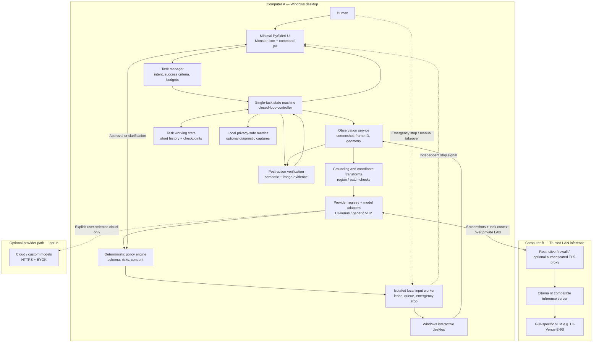
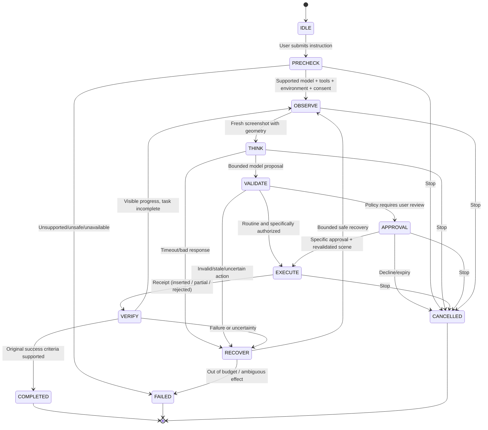

# Monster — Reliable Computer-Use Agent Architecture (v2)
**Architecture decision record and implementation specification**  
**Date:** November 6, 2026  
**Primary target:** Windows 11 x64, interactive standard-privilege desktop  
**Interaction contract:** Screenshot + Mouse + Keyboard only for target applications  
**AI default:** Privately hosted GUI vision model (UI-Venus-2-9B candidate); model and inference runtime replaceable  
**UX:** One tiny cursor-following Monster character; one on-demand communication pill

> **Design objective:** Maximize *verified successful user outcomes*, not autonomy or click throughput. Prevent unobserved or unsafe side effects. Do not claim arbitrary computer use is reliable before representative Windows testing.

## 0. Starting point: preserve existing Monster implementation

Repository `ericwangAISavy/Monster` already contains, as checked on `main`:
- PySide6 cursor companion, command pill, tray, and settings.
- Windows screenshot/mouse/keyboard components, real input worker, stop/watchdog protections.
- Native Ollama configuration and vision/JSON compatibility preview.
- An **experimental supervised real-input controller**, with per-action approval by default, a bounded observe–act–verify loop, and human confirmation for final success.
- Docs: `docs/ARCHITECTURE_PLAN.md`, `docs/CURSOR_COMPANION.md`, `docs/COMPUTER_TOOLS.md`, `docs/OLLAMA.md`, `docs/SUPERVISED_EXECUTION.md`.

The existing experimental system is **not yet qualified on real Windows hardware** merely because portable/fake-input tests pass. Preserve these modules and interfaces; perform an incremental, test-driven extension rather than rebuilding. Existing supervised limits include 10 input transactions, 20 planning calls, five minutes, and 60-second per-step approval expiry. These are conservative prototype limits, not product guarantees.

## 1. Non-negotiable principles

1. **Three tools only for target-app tasks:** screenshots, mouse events, keyboard events. No Outlook Graph, browser DOM, Selenium/Playwright, shell scripts, accessibility-tree shortcuts, clipboard APIs, or application document APIs used to complete tasks. Windows APIs used for capture, input, cursor geometry, safety, focus validation, and Monster's own overlays are allowed as infrastructure.
2. **Closed-loop control:** Observe → Decide → Validate → (Approve if needed) → Execute → Observe → Verify. Never treat successful `SendInput` insertion as task success.
3. **Local-first and model-agnostic:** inference can run on local/LAN Ollama, a compatible local model server, or an explicitly chosen cloud provider. No silent switching or cloud uploads.
4. **No unreviewed consequence:** sending email, deleting/modifying valuable data, purchases, installs, credentials, administrative operations, and other sensitive actions stay behind policy and explicit consent; initially keep them out of the supported operating envelope.
5. **Human authority:** emergency stop works independently of UI and model latency; manual takeover disarms control; no background unattended operation initially.
6. **Privacy by default:** screenshots and typed content in memory; no default frame/transcript storage; no secret leaks in logs; locally served image processing requires trusted server/network.
7. **Prove reliability:** collect measured data from the exact model checkpoint, quantization, runtime, GPU, Windows build, screen/DPI environment, and task set.

## 2. Reference architecture



**Process separation:** Keep the existing one desktop app with PySide6 UI + background inference controller + dedicated, no-network input worker process. Do **not** create microservices on the user's PC. The only remote service is the model server. Local input worker accepts a tightly constrained action protocol and never accepts raw model text or code.

## 3. Control-plane and data-plane components

| Component | Owns | Must *not* do |
|---|---|---|
| Companion UI | Intent input, status, review/approve, settings, stop; two tiny overlay surfaces | Perform input events or block the model loop |
| Task manager | One task, original objective, visible success criteria, deadline, budget, cancellation generation | Assume model `Finished` equals success |
| Observation service | Screenshot bytes, image hash, frame timestamp, pixel dimensions, monitor origin/DPI, foreground guard | Read application semantic APIs |
| Model adapter | Images/prompts in provider format; parsed candidate decision; normalize provider-specific coordinates/action vocabulary | Call Win32 input, mutate filesystem, set risk policy |
| Grounding | 0–999 → screenshot pixel conversion for UI-Venus, then screenshot → physical desktop coordinate transform; crop provenance | Guess coordinate systems silently |
| Policy | Strict action schema, supported action allowlist, stale-frame rejection, UI/OS restrictions, risk/approval routing | Trust risk tags solely because the model says `routine` |
| Executor | Single writer to Windows input, short leases, foreground/geometry checks, stop, release owned keys | Accept raw Python, shell, DOM, or unconstrained action sequences |
| Verifier | New screenshots, expected-result visual predicates, progress/no-progress detection, final task criteria | Equate input receipt with success |
| Working memory | Task step records, durable-only safe checkpoints, expected state, controlled image history | Persist private screenshots by default |
| Telemetry | Timing/failure categories and opt-in redacted traces | Store API keys or email bodies in logs |

## 4. End-to-end task lifecycle



**Critical rule:** An approval is bound to `{task_id, frame_id, action_hash, screen_geometry, target_identity, expiry}`; the target scene is rechecked immediately before input. Any mismatch invalidates approval. Sensitive clicks cannot be confidently classified from pixels alone; default to review.

## 5. Data contracts (illustrative, versioned)

### Observation

```json
{
  "version": 1,
  "observation_id": "obs_0012",
  "captured_at_monotonic_ms": 9120442,
  "display_id": 1,
  "image_size_px": [2560, 1440],
  "desktop_origin_px": [-2560, 0],
  "dpi_context": "per-monitor-v2",
  "foreground_guard": "opaque-runtime-handle",
  "image_sha256": "<hash>",
  "image_bytes": "<in-memory PNG bytes only>"
}
```

### Normalized proposed action

```json
{
  "schema_version": 1,
  "observation_id": "obs_0012",
  "task_step": "Focus the search box",
  "action": {"type": "mouse.click", "point_px": [1480, 132], "button": "left"},
  "expected_visual_change": "Search box receives focus",
  "model_risk_hint": "routine",
  "needs_verification": true
}
```

The model's risk hint is **advisory only**. The local policy determines real authorization. Coordinates are mapped to **native desktop physical pixels**, not Qt DIPs and not arbitrary model units. Include a step-level provenance record for mapping; prevent stale click-by-coordinate replays. Use typed Pydantic discriminated action variants, with size limits, finite numeric checks, allowed keys/chords and text bounds. **Never `eval`/`exec` model outputs.**

### Input receipt and verification

```json
{
  "action_id": "act_0012",
  "input_receipt": "inserted",
  "verified": "uncertain",
  "evidence": "Focus ring is not clearly visible",
  "next": "reobserve_without_replaying_action"
}
```

Receipt values should distinguish `inserted`, `rejected`, `partial_or_unknown`. Verification values should distinguish `supported`, `contradicted`, `uncertain`. The latter two must not be silently treated as progress.

## 6. Model intelligence: one model initially, optional split later

### Recommended v2 default

**UI-Venus-2-9B with Q6_K as a candidate**, served locally (Ollama if the exact vision projector/checkpoint works; otherwise a compatible llama.cpp or vLLM server). This is a candidate based on weight-memory tradeoffs and GUI specialization, **not a measured latency or quality winner** for Monster. Fix a checkpoint and test Q5, Q6, Q8 on the same workloads.

The upstream UI-Venus computer example uses a specialized computer action vocabulary and **normalized 0–999 coordinates**. It parses actions with a safe AST parser and provides normalization helpers. Mirror the *meaning* of its parser under a versioned `UIVenusAdapter`; do not force it to behave like a generic `{"action":"click"}` JSON response without testing. Normalize its terminal signals (`Finished`, `CallUser`) but apply Monster's independent verification and approval rules. The upstream example processes screenshot sequences and does not execute host input.

### Provider interface

```python
class VisionAgentProvider(Protocol):
    async def health(self) -> ProviderStatus: ...
    async def list_models(self) -> list[ModelDescriptor]: ...
    async def probe_vision(self, model: str) -> CapabilityProbe: ...
    async def next_decision(self, request: DecisionRequest) -> CandidateDecision: ...
```

Adapters: `OllamaNative`, `UIVenusComputer`, `OpenAICompatibleVision`, `GeminiVision`, `AnthropicVision`, `OpenRouterVision`, `GroqVision`. A compatible API protocol **does not imply** compatible image, reasoning, action schemas, or native tool behavior. Each adapter advertises and tests its actual capability and request limits.

Use a **single model** for plan/act/verify in the first release. Only introduce a second planner/independent verifier after measurements demonstrate a meaningful gain; multi-model voting on every click can increase latency and share correlated errors.

### Inference performance policy

- Keep the selected model loaded on the LAN server when practical; measure cold-start separately.
- Send **one fresh screenshot** plus compact task state; retain up to a small, configurable number of previous frames if the model requires history.
- Crop high-resolution regions only with accurate metadata/coordinate mapping; do not resize away tiny controls without checking grounding impact.
- Batch *safe atomic inputs* (key chord, double-click, bounded text entry) but **not blind navigation through several screens**.
- Run one bounded inference request at a time per desktop session; invalidate late replies when task/frame/model changes.
- Set per-request deadline and overall task budget; expose slow server and unavailable model errors without guessing.
- Record end-to-end latency as `capture + transfer + queue + inference + validation + execution + visual settle + verification`.

## 7. Safety architecture (hard enforcement)

### Three operation levels

| Level | Example | Default policy |
|---|---|---|
| Low-risk routine | Move mouse, focus blank test editor, type bounded harmless text, navigate known UI | Automatic only after Windows qualification and task-specific authorization; per-action approval default in experimental mode |
| Consequential | Send email, post message, save over a file, share data, bulk modifications | Human review of exact target, payload and effect; revalidate before dispatch; initially outside MVP |
| Prohibited/unsupported initial scope | Purchases, transfers, credential handling, OS administration, installations, destructive unbounded actions, elevated/UAC/secure desktop | Refuse/stop in MVP; no bypasses |

Treat all text *seen on the screen* as untrusted, including email contents, websites, documents and dialogs. Visual instructions must not override the human's task, policies or tool boundaries. The policy must resist prompt injection; require an approval token tied to what will actually happen.

### Kill-switch and manual takeover

Retain the existing independent worker hotkey **Ctrl+Alt+X** and input lease/watchdog. Every command is scoped to an active task generation, recent screenshot, expected geometry and bound foreground target. Losing the parent heartbeat, a lock screen, display change, user takeover or a tool failure disarms further inputs. Release any input owned by Monster when possible. On partial/unknown insertion stop **without automatic replay**, because duplicate typing/clicking could be harmful. An input worker is an isolation/reliability boundary, not a security sandbox.

Do not advertise the emergency stop as hard-real-time or capable of overcoming OS stalls. Measure it on actual Windows systems.

### Local data/network security

- Never expose unauthenticated Ollama TCP directly on the public internet. Bind to a private interface, restrict firewall to Monster's IP, or use authenticated TLS reverse proxy/VPN when off-LAN.
- Distinguish Ollama **local weights** from cloud-backed model routing; verify the server's runtime privacy setting.
- Store cloud API keys only in Windows Credential Manager (or equivalently secure OS storage); no keys in `.env` committed to Git.
- No screenshot/transcript capture to disk without explicit opt-in. Make diagnostic images user-reviewable and expire them.
- Pin downloads/checkpoint hashes and check model licenses before shipping.

## 8. Minimal GUI, serious engine

Two daily-use surfaces only:

- `CompanionOverlay` — tiny (~44 px body), transparent, click-through, follows **actual** cursor with visual easing and offset, never emits input.
- `CommandPill` — ~324×46 DIP, hidden by default, activated by Ctrl+Alt+M/tray; accepts instruction, short state notices, focused approvals. It **stops moving while editing**. Settings in tray/secondary screen only.

The agent engine drives events like `TaskStarted`, `Observing`, `Planning`, `Acting`, `Verifying`, `ApprovalNeeded`, `Stopped`, `Completed`, `Failed`. Do not expose hidden reasoning in UI; show brief intent and verified results.

**Screenshot isolation:** prefer tested `WDA_EXCLUDEFROMCAPTURE` for Monster's top-level overlay windows; keep the already-implemented hide-before-capture fallback, restore overlays after each frame, and validate actual captured pixels. On Windows 10 2004+ the affinity flag is supported by the OS, but it is not a general security guarantee or universal capture-backend guarantee. Do not create a fullscreen transparent click-catching overlay.

## 9. Reliability framework: what success actually means

Define an unambiguous *visible completion contract* before executing each task. Examples:
- Notepad: specific text visible in intended editor.
- Chrome search: results page visibly corresponds to user's query; not a claim that results are true.
- Outlook draft: correct recipient/thread/body visible in a **draft**, not `sent`.
- Email sent: independently verified sent state, only after explicit approval; a click alone is not proof of delivery.

For every action:
1. Check screenshot freshness and geometry.
2. Detect no-progress loops using recent task state + frame evidence + action class, not image hashes alone.
3. Validate action against a typed schema and policy.
4. For clicks on tiny/ambiguous targets, use a permitted zoom/crop/second visual confirmation rather than guessing.
5. Execute only a bounded atomic transaction.
6. Capture post-state, verify expected effect, record uncertainty separately.
7. On a mismatch, *replan* with a new screenshot, with a small retry budget. Do not click repeatedly in roughly the same area.
8. For non-idempotent operations (send, delete, payment, save), never auto-retry after ambiguous result.

### Metrics and proposed release gates (targets, not achieved measurements)

| Metric | Measurement | Initial gate |
|---|---|---|
| Safety violation | Any unintended consequential action | **Zero observed** across qualified test suite; any occurrence blocks release |
| Routine task completion | Human-checked success over standardized Windows tasks | At least **95%** on a fixed, documented *narrow* Notepad/search test suite before advertising hands-off automation |
| False completion | Agent says completed but contract unfulfilled | **Zero observed** in release regression suite |
| Emergency disarm | Time until no new automation can be initiated after stop | Record p50/p95/p99 on hardware; set an achievable threshold after measurement |
| Click grounding | Correct target hit across held-out screenshots | Report per-target and per-DPI, including small controls |
| Latency | p50/p95 wall-clock verified step, cold vs warm | Optimize actual task time after establishing accuracy |
| Recovery | Bounded recovery of moved dialogs/windows | Report success and no-progress stop rate |

Never infer safety/reliability guarantees from a tiny clean benchmark. A 95% task success rate still means 1 failure in 20 tasks; consequential workflows require stronger controls than a high score.

## 10. Reference execution: urgent Outlook email

Human: **“Find my newest urgent Outlook email and prepare a reply.”**

1. Interpret task as **draft only**, not send.
2. Ask for ambiguity resolution if multiple emails are comparably urgent or if required reply content is missing.
3. Capture desktop, identify visible Outlook UI, open by mouse/keyboard, verify launch.
4. Navigate visibly to inbox/search, inspect recent messages and priority/context. Treat message content as *data*, not instructions to agent.
5. Choose email using explainable evidence from visible UI; no Microsoft Graph.
6. Draft a conservative reply (avoid invented commitments), enter via keyboard.
7. Verify thread, recipients, body, draft state on screen; report **“Draft prepared for review.”**
8. To actually send, require explicit user approval in a separate step and independent post-send verification. Never infer from click alone that delivery occurred.

**Do not run this on personal/confidential email until native Windows testing, grounding quality, privacy handling and approval controls have passed their gates.**

## 11. Incremental roadmap for the existing repo

| Order | Deliverable | Exit criteria |
|---|---|---|
| **0 — Windows qualification (next)** | Run existing `docs/COMPUTER_TOOLS.md`, `docs/OLLAMA.md`, `docs/SUPERVISED_EXECUTION.md` on an actual Windows PC with disposable Notepad | Capture exclusion, focus restore, click mapping, keyboard, stop, locks, failed inputs and server timeouts verified with evidence |
| **1 — UI-Venus native adapter** | Model-specific prompt, 0–999 conversion, action parser, terminal mapping and image multimodal compatibility | Screenshots → correctly normalized action previews on held-out examples, *no real input* initially |
| **2 — Grounding benchmark** | Screenshot suite covering 100/125/150/200% DPI, multiple displays, small buttons, dialogs, dark/light, resizes | Compare Q5/Q6/Q8 and runtimes on target GPU; measure click target accuracy/latency |
| **3 — Supervised loop hardening** | Wire UI-Venus into existing supervised controller, approval binding, verification and bounded recovery | Reliable, fully supervised Notepad tasks on physical Windows; no phantom completion |
| **4 — Bounded automatic routine tasks** | Per-action risk policy, manual takeover detection, safe action batching | Repeat clean low-risk workflows at measured success targets; correct stop/fail behavior |
| **5 — Cross-application workflows** | Chrome, test mail client, file dialogs within strict scope | Verified outcomes with no unintended send/delete/other side effects |
| **6 — Multi-provider options** | Provider registry + cloud BYOK adapters + selected-model capability probes | No engine modification when switching capable models; no silent cloud transfer |
| **7 — Optional workflow hints** | Consent-based stored semantic plans and repair hints, no fixed-coordinate macros | Faster repeated tasks with measurable accuracy preserved; no default sensitive persistence |
| **8 — Release hardening** | Packaging, signing, crash recovery, observability, accessibility, licenses, offline installer | Clean Windows VM qualification and documented support boundaries |

**Do not build a multi-agent swarm, always-on recording service, vector database, or remote desktop-control server in the first product.** They increase complexity, latency and security surface before the core single-agent controller is reliable.

## 12. Recommended repository evolution

Preserve the existing packages; introduce only missing interfaces:

```text
src/monster/
  app.py                       # existing companion entry
  ui/                         # existing 2-surface presentation
  capture.py                   # existing capture isolation
  computer/                    # existing screenshot + worker + native input
  providers/
    base.py                    # existing common interface
    ollama.py                  # existing native Ollama adapter
    decisions.py               # existing action schema
    ui_venus.py                # NEW native model/format adapter
    provider_registry.py       # LATER cloud/custom selection
  agent/
    controller.py              # existing supervised state machine
    validation.py              # existing policy + scene checks
    input_bridge.py            # existing bounded worker bridge
    completion.py              # NEW task completion contracts
    recovery.py                # NEW no-progress and safe recovery logic
    metrics.py                 # existing diagnostics
  evaluation/                  # NEW offline screenshot replay harness
    datasets.py
    benchmark.py
  security/                    # introduce only when code growth justifies
    credential_store.py
    risk_policy.py

tests/
  fixtures/gui_synthetic/     # generated/non-private only
  test_ui_venus.py
  test_grounding.py
  test_completion_contract.py
  test_stop_recovery_windows.py  # Windows runner + manual acceptance

docs/
  ARCHITECTURE_PLAN.md         # existing
  CURSOR_COMPANION.md          # existing
  COMPUTER_TOOLS.md            # existing
  OLLAMA.md                    # existing
  SUPERVISED_EXECUTION.md      # existing
  RELIABILITY_BENCHMARKS.md    # NEW model/hardware/task results
```

## 13. Exact next development task for Codex

> **Inspect Monster's current `main` branch before changes. Preserve all existing GUI, computer tool, Ollama, supervised execution and safety code. First qualify existing real Windows behavior using documented checklists (where a Windows machine is available), then implement an isolated `UIVenusComputerAdapter` for the upstream computer action format and 0–999 normalized coordinates. Start with screenshot-to-action previews and fake-input tests only. Do not change control/safety policies or enable unattended actions. Add offline fixture tests for coordinate mapping, parsing, invalid actions, stale observations, terminal signals and incomplete/ambiguous outcomes. Document exact model-serving compatibility and any native Windows tests that cannot run in the environment.**

## References and implementation evidence

- Monster current source: https://github.com/ericwangAISavy/Monster
- UI-Venus-2 upstream computer example, action vocabulary, 0–999 normalized coordinates: https://github.com/inclusionAI/UI-Venus/blob/UI-Venus-2/models/computer/README.md
- UI-Venus-2 model/research: https://github.com/inclusionAI/UI-Venus/blob/UI-Venus-2/README.md
- Microsoft `SetWindowDisplayAffinity` / `WDA_EXCLUDEFROMCAPTURE`: https://learn.microsoft.com/en-us/windows/win32/api/winuser/nf-winuser-setwindowdisplayaffinity
- Ollama network binding: https://github.com/ollama/ollama/blob/main/docs/faq.mdx
- Ollama vision input: https://ollama.com/blog/vision-models
