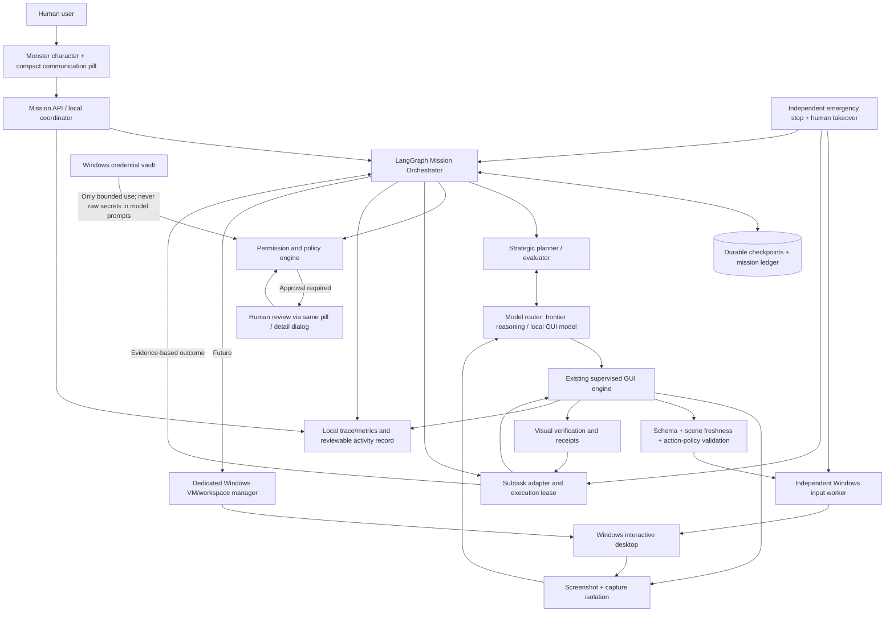
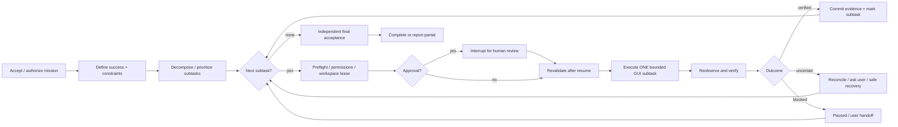

# Phase 1 implementation status — November 7, 2026

The blueprint below is the adopted target direction, not a claim that later phases
are implemented. **Phase 1 is fake-only and is not connected to the desktop GUI.**
Existing settings, controller, input worker, approval rules and emergency stop are unchanged.

Implemented modules in `src/monster/mission/`:

| Module | Responsibility |
| --- | --- |
| `contracts.py` | Strict versioned Mission, Subtask, TaskResult, Effect, Approval and bounded approval decisions; status/transition definitions; v0→v1 state migration. |
| `repository.py` | Transactional v0→v1→v2 ledger migration, compare-and-set effect transitions, immutable mission plan, control generation, content-free metrics/events, runtime lock and retention eligibility. |
| `graph.py` | Async LangGraph authorize → static plan → choose → preflight → optional approval interrupt → delegate → assess → checkpoint → choose/complete; durable effect guards and bounded loops. |
| `coordinator.py` | Explicit async start/snapshot/resume/stop/continue/reconcile API; AsyncSqliteSaver, stable `thread_id=mission_id`, operation reservation and tracing disabled. |
| `runner.py` | Async `GuiSubtaskRunner` protocol and deterministic fake implementation. Coordinator explicitly rejects non-fake runners in this release. |
| `demo.py` | Offline approval/restart and ambiguous-dispatch demonstrations; no screenshot, model request or input. |

### Storage and recovery contract

Use an explicitly chosen private local directory, preferably on an encrypted user
volume. `ledger.sqlite3` is the authority for effect intent/outcome; `checkpoints.sqlite3`
holds LangGraph progress. Both use SQLite WAL; ledger uses FULL synchronous commits.
They are intentionally separate transaction domains: effect intent commits **before**
runner invocation, and result evidence commits **before** returning to the graph.
Graph invocation uses `durability="sync"`. An OS-held exclusive runtime lock prevents
a second coordinator from opening the same state directory; it releases on process
exit. This is single-machine storage, not a distributed workspace lease or a sandbox
against malicious local programs. Checkpointer table setup is library-owned; app
schema migrations run in an explicit SQLite transaction. Future app versions fail closed.

On restart, any `dispatch_started` ledger entry becomes `uncertain` and prevents
new delegation until explicitly reconciled. Replayed nodes consult the ledger;
even if graph progress lags an already-committed observation, they never redispatch.
Verified completion requires evidence-bearing observed success for every subtask.
Input acceptance and a checkpoint cannot satisfy that criterion. Fake evidence is
always labeled fake; it proves no desktop behavior. Phase 1 never automatically
retries failed/ambiguous effects or regenerates a plan.

Approvals bind one mission/subtask/effect/generation and expiry. They contain no
commands or capability escalation. Consequential/unknown categories always review,
even if `requires_approval=False`. Denial/expiry returns partial; malformed/unbound
results and runner errors pause uncertain. Stop invalidates the generation; cancel
is irreversible. A paused ambiguous effect requires `reconcile()` with a bounded,
evidence-bearing result. Old prepared/approved grants invalidated by a manual stop
cannot authorize dispatch; an outstanding approval will fail closed, so create a
fresh mission if fresh authorization is needed. Automatic reauthorization is deferred.

`prune(retention_days=30)` is explicit, limited to 1–365 days, and removes only old
terminal missions with no unresolved dispatch/uncertainty. Active/paused records
remain for review. Checkpoints are removed before journal metadata so an interrupted
prune can be repeated safely. No automatic vacuum or retention-based deletion of
unresolved outcomes occurs. Runtime storage should never be committed/shared casually.

### Privacy boundary

Phase 1 persists **opaque objective/criteria/application/evidence references**, IDs,
closed status/reason codes, model identity and numeric timings/budgets. It deliberately
does not accept arbitrary natural-language task contents. Caller-supplied IDs must
also be non-sensitive; an alphanumeric secret is still a secret. No field validator
can establish that arbitrary user text is non-sensitive. Resolve content transiently
in a future approved adapter, outside checkpoints. Extra fields, bytes, arbitrary
commands, nonfinite values and out-of-range budgets are rejected. Raw errors/results
are converted to fixed reason codes. LangSmith tracing is disabled even when global
tracing environment variables are present. SQLite is **not encrypted by this phase**;
use OS access controls/encrypted storage. No credentials, screenshots, typed content,
model reasoning or environment dumps belong in this store.

### Try the offline simulations

From the repository root (both commands generate a new mission ID):

```powershell
uv sync --frozen
uv run python -m monster.mission.demo --directory .monster-missions --scenario approval
uv run python -m monster.mission.demo --directory .monster-missions --scenario crash
uv run pytest tests/mission -q
```

Approval scenario: two fake subtasks verified, third waiting for approval; close and
reopen the coordinator/checkpointer, approve that one fake effect and finish all three.
The scenario explicitly manufactures approval **only for its fake test data**. Crash
scenario: dispatch-started → simulated hard failure → reopen → uncertain/paused with
one total dispatch. The tests also use a genuinely separate process and `os._exit`
to prove the durable boundary. Nothing in either command operates a target app.

The async API uses `async with MissionCoordinator(directory) as c`, then `await
c.start(Mission(...))`. `Mission` requires explicit `authorized=True` and a UTC epoch
deadline to progress. `snapshot()` returns metadata; `resume()` accepts only an
`ApprovalDecision` bound to the pending approval. `stop(cancel=True)` cancels;
`stop()` pauses. `continue_mission()` is explicit restart/recovery, not input replay.
Use one asyncio event loop per coordinator and await its closure. Do not call these
methods on Qt widgets or run a blocking graph on the Qt main thread.

### Recommended Phase 2 gate

Add a Qt-signal/future bridge implementing `GuiSubtaskRunner`, with one workspace
lease and execution-generation binding. Resolve objectives in volatile memory,
reuse the existing SupervisedController and its one input worker, and preserve every
inner-loop approval, capture isolation, foreground check, budget and stop guarantee.
Runner completion must mean worker cleanup and fresh verification, not merely a
Qt finished signal. Add cancellation/late-result/crash tests before enabling that
adapter explicitly. Then qualify two harmless native Windows subtasks, user takeover,
Ctrl+Alt+X, overlays and Stop latency. No scoped autonomous default or new provider
is enabled by Phase 1. Strategic model planning/replanning belongs to a later gate.

Exact validation evidence and native limitations: [Phase 1 implementation summary](MISSION_PHASE1_IMPLEMENTATION.md).

---

# MONSTER v3 — Long-Horizon Autonomous Computer Agent

**Architecture status:** implementation blueprint, not a claim of validated autonomy.
**Target:** Windows 11, local UI, optionally isolated Windows workspace, local/LAN or explicitly configured cloud vision models.
**Product:** a miniature cursor-following Monster and a compact communication pill; the substantial agent system operates behind this tiny interface.

## 0. Executive decision

Use **two bounded orchestration layers** rather than one giant LLM loop:

1. **Mission Control (LangGraph):** durable, high-level planning, subtask scheduling, policy approvals, handoffs, replanning, checkpoints, and mission outcomes.
2. **GUI Execution (the existing Monster engine):** short, observed computer-use transactions: screenshot → model decision → local policy validation → authorized input → screenshot verification.

The mission layer delegates one bounded subtask at a time to the GUI layer and receives a **structured evidence-based result**. Only the existing Windows input worker is permitted to generate system mouse/keyboard events. LangGraph **never** directly invokes `SendInput`, replays old mouse coordinates, or bypasses safety decisions. The model may propose actions, but only deterministic local code approves and dispatches them.

**Three target-app interaction primitives remain:** screenshot, mouse, keyboard. Normal internal APIs (model inference, checkpoint database, vault, configuration, local IPC) are infrastructure, not shortcuts into target apps. For the GUI-only product variant, do not use DOM, accessibility-tree text, browser automation, target-app APIs, hidden filesystem edits, or arbitrary shell tools to complete tasks. Terminal/IDE typing through the GUI is a *high-risk mode*, separately permissioned and initially available only in disposable workspaces.

### Current repository grounding (verified November 7, 2026)

Repository: `ericwangAISavy/Monster`.

Existing, preserve rather than rewrite:

- `src/monster/app.py` and `src/monster/ui/*`: small PySide6 creature and pill, tray/settings.
- `src/monster/lifecycle.py`: Qt `TaskController` lifecycle contract and mock GUI controller.
- `src/monster/agent/controller.py`: experimental `SupervisedController`, one-step model/capture/approval/input/verification loop; currently a large Qt-bound controller.
- `src/monster/providers/base.py`, `ollama.py`: provider protocol, Ollama vision/action/verification.
- `src/monster/agent/validation.py`: observation binding and local action rules.
- `src/monster/computer/*`: screenshot, Windows input process and independently registered emergency stop.
- `docs/SUPERVISED_EXECUTION.md`, `docs/COMPUTER_TOOLS.md`: initial safety and manual qualification procedures.
- Automated tests cover various mocked logic; **native Windows reliability and general long-horizon autonomy are not yet established**.

Existing supervised-mode conservative budgets (10 input transactions, 20 planning calls, 5 minutes) should not be silently raised to support an unbounded task. Instead, create *multiple bounded GUI subtasks* managed by a higher-level durable mission.

## 1. What “autonomous” means

A mission can span several applications, many subtasks, human-approval interruptions, and restarts. A mission is **not** one long stream of screenshots and unlimited clicks. It is a sequence of independently verifiable achievements, with durable progress and bounded tool permissions.

Example missions:

- Job assistance: research jobs; assess fit against truthful user-provided history; prepare applications; show source evidence, answers and attachments; submit only when explicitly approved; record a verified submission outcome; never fabricate education, employment or work eligibility.
- GUI-only software development: inspect requirements; plan; use an authorized IDE/design tool through its GUI; edit code; run tests through permitted visible UI/terminal; inspect errors; iterate; demonstrate the application; request approval before deployments, publishing, destructive commands or sharing credentials. This is materially slower and less reliable than direct development tools and must be evaluated accordingly.
- Account management: help create/manage accounts the user is entitled to operate, with honest identity details and compliance with platform rules; hand off email/phone verification, CAPTCHA, MFA or identity checks; no bypass, impersonation or deceptive mass social engagement.

## 2. System diagram



### Plane boundaries

| Plane | Owns | Must **not** own |
|---|---|---|
| UI/presence | Cursor companion, small prompt, consent, status, review | Planning semantics, keyboard injection |
| Mission | Durable task DAG, priorities, dependencies, checkpointing, resumption, recovery strategy | Direct GUI input or stale coordinates |
| Cognition | Model-specific planning and screenshot interpretation, structured proposals | Safety authority, access to raw credentials |
| Execution | One bounded visual subtask, fresh action verification, result receipts | Cross-day mission planning |
| Policy | Capability grants, user approvals, data egress consent, local action allowlist | Delegation of enforcement to model output |
| Persistence | Mission/subtask/effect ledger, verified outcomes, minimal evidence references | Raw screenshot hoarding or passwords |
| Environment | Desktop ownership, input lease, session health, optional dedicated VM | Unrestricted concurrent mouse owners |

## 3. Mission orchestrator: LangGraph with a stable seam

Prefer LangGraph at the mission level because of checkpointing and interrupts, **not** because it makes screenshot reasoning intrinsically better. A local SQLite-backed persistent checkpointer is acceptable for the first single-user milestone; PostgreSQL becomes relevant for multiple machines or concurrent workspaces. Confirm the currently installed `langgraph` and checkpointer package APIs before coding.

**Mission graph:**



Important: use **persistent `thread_id` = mission ID**, not a new ID per call. Never store enormous image bytes in graph state. Store content hashes, small task summaries and optionally encrypted evidence pointers. Persist checkpoint *at meaningful subtask boundaries* and keep a separate effect ledger for external actions.

### Proposed typed mission state (contract, not final library binding)

```python
class MissionState(TypedDict):
    mission_id: str
    user_goal: str
    workspace_id: str
    status: str  # planned/running/waiting/blocked/partially_complete/completed/failed
    user_constraints: dict
    capability_grants: list[dict]
    plan_version: int
    subtasks: list[dict]             # IDs, goals, dependencies, criteria, statuses
    current_subtask_id: str | None
    verified_results: list[dict]     # bounded evidence summaries, never model-only claims
    pending_effect_id: str | None
    pending_approval_id: str | None
    next_action_hint: str | None     # NOT a replayable mouse command
    token_budget: int
    deadline_utc: str | None
    last_checkpoint_utc: str | None
```

Subtasks include *goal*, *preconditions*, *visible success predicates*, *allowed application/workspace*, *side-effect classification*, *deadline*, *retry budget*, *dependencies* and *approved resource limits*.

## 4. GUI subtask contract (between LangGraph and current engine)

LangGraph submits a bounded job and **awaits result**, not a synchronous 1,000-click loop in one graph node. Keep UI responsive through the existing Qt signals/worker model; the mission layer talks to an adapter, not directly to `QWidget` or `SupervisedController` internals.

```json
{
  "subtask_id": "st_008",
  "mission_id": "m_123",
  "workspace_id": "win-session-1",
  "objective": "Open a disposable Notepad document and type the specified sentence",
  "success_criteria": ["Editor visible", "Exact requested sentence visible in editor"],
  "allowed_tools": ["screenshot", "mouse", "keyboard"],
  "risk_mode": "test_low_risk",
  "max_actions": 10,
  "max_model_calls": 20,
  "deadline_seconds": 300,
  "approval_policy_id": "policy_default_v1",
  "execution_generation": 7
}
```

Results are `verified_success | verified_failure | uncertain | needs_human | blocked | cancelled | timed_out`. Every result contains an evidence reference (or honest absence), model identity, elapsed time, transaction IDs and a concise human-readable reason. The orchestrator must **not** treat `input_inserted` or an LLM's `done` text as proof of success.

### Two distinct loops

- **Outer mission loop:** plan → choose subtask → delegate → inspect evidence → checkpoint → replan. Frequency: roughly per objective or meaningful milestone.
- **Inner GUI loop:** screenshot → visual model → normalize proposal → validate and authorize → fresh scene recheck → input → screenshot → verify. Frequency: roughly per meaningful mouse/keyboard transaction.

**Never checkpoint a pending mouse action and later replay it as the next command.** State should say “result uncertain; reconcile against live UI,” not “click Send again.”

## 5. Exact-once *intent* handling, not impossible exact-once GUI promises

GUI applications have no guaranteed transactional idempotency. Monster must implement an **effect ledger** around consequential actions:

- Effect categories: `read_only`, `local_reversible`, `external_commit`, `destructive`, `credential_or_identity`, `unknown`.
- Before consequential input, create `effect_id`, expected target, user authorization scope and status=`prepared`.
- Require approval as dictated by policy; append `approved` with user, timestamp and consent scope.
- Immediately before input, verify live screen, focus, permissions and task generation.
- Mark `dispatch_started`, pass action to the single-writer input process and record its receipt.
- Observe the real outcome; mark `observed_success`, `observed_failure` or `uncertain`.
- On restart, **never auto-repeat effects left in `dispatch_started` or `uncertain`**. Reconcile visually or request human review.

There cannot be a strict exactly-once guarantee for arbitrary GUI actions. The ledger is a best-effort audit and duplicate-prevention mechanism.

## 6. Model strategy and performance

Build model selection as **an adapter and capability registry**, not a hard-coded 'model X always does task Y' rule. Recommend:

- **Strategic planner:** capable multimodal/reasoning model, chosen by user from configured models; expensive reasoning only when planning or recovering.
- **Operational GUI controller:** specialized GUI model (e.g., UI-Venus if its runtime, visual input and action format pass actual compatibility probes), or strong general computer-use model.
- **Verifier:** structured screenshot-driven assessment plus deterministic predicates (geometry, receipts, exact visible target where obtainable visually). Do not call an LLM twice and assume independence.

Provider adapter must normalize native computer-use actions (including coordinate scales) to a Monster schema. A model's claimed coordinate system is metadata—not blindly executable screen coordinates. Require calibration tests for screenshot rescaling, virtual monitor bounds, DPI and normalized coordinates. No silent cloud fallback; ask for explicit approval of screenshot transfer and provider-specific privacy conditions.

Optimize **time to verified task completion** rather than tokens/second. Preserve model identity and settings per subtask to reproduce failures. Batching is permitted only within a safe, observed stable state; never batch blind navigation across multiple pages.

## 7. Permissions, credentials, safety, identity

### Permission modes

1. **Observe only** — capture/interpret; zero input.
2. **Supervised** — approve every transaction; existing behavior.
3. **Scoped autonomous** — low-risk navigation and approved local edits, within a pre-authorized workspace/application set and strict budgets; default off until demonstrated safe.
4. **Consequence review** — always require confirmation before submitting applications, sending/publicly posting content, creating accounts, deploying code, transferring data, purchases, destructive changes or altering identity/account settings.

Model risk labels can **escalate** but never reduce deterministic enforcement. Site text, emails and documents are untrusted task data; do not let prompt injection reauthorize new goals or secrets. Provide emergency stop independent of model runtime; user input should request takeover/stop. Use dedicated Windows sessions/VMs when automation would monopolize a user's cursor.

### Credentials and verification

- Windows Credential Manager or approved OS vault; no keys/passwords in LangGraph checkpoints, prompts, logs, or debug screenshots by default.
- Where feasible, user performs the actual password/MFA entry while Monster pauses observation (privacy curtain) and input; resume after authorized authentication is complete.
- No automated CAPTCHA bypass, human-verification evasion, fabricated identity, impersonation, spam, or deceptive social interactions. Platform restrictions and explicit user authorization are first-class limits.
- Screenshot egress: separate consent scopes per provider/mission; local model doesn't imply host is secure. LAN server firewall restrictions/authenticated private transport required.
- Deployment, terminal commands, Git pushes, arbitrary scripts run through a visible GUI are still **real side effects** and require stronger permissions in isolated test environments.

## 8. Execution environment

**Personal desktop mode:** visible cursor companion; one active Monster writer per interactive session; pause/disarm on focus theft, lock, display changes, user takeover, or lost lease.

**Dedicated workspace mode (future):** one Windows VM/remote interactive session per mission, with single cursor owner and screenshot/click transport. Work can continue without stealing the user's primary pointer, but the user must be able to inspect, stop and approve it. Verify session lock/remote-capture semantics; no bypass of Windows secure desktop.

Persistence is not background execution by itself. A mission only progresses when an authorized runtime is online, owns an active workspace, and meets scheduling and consent conditions.

## 9. Fault tolerance and recovery

| Failure | Required response |
|---|---|
| Model timeout / invalid structured output | Retry within bounded reasoning budget, with no input replay; maybe switch model only after user approval where necessary. |
| Screenshot stale / unexpected window / focus lost | Disarm input, recapture, request safe replan; don't reuse old coordinates. |
| App seems stuck | Bounded wait, distinguish loading from failure, then ask or try non-destructive recovery. |
| Insertion receipt ambiguous | Mark effect uncertain; inspect on-screen result; never duplicate text blindly. |
| Crash between dispatch and checkpoint | On restart reconcile effect ledger and live application state before selecting any next action. |
| Human takes over / global stop | Invalidate task generation; stop worker, clean held input, preserve mission as interrupted. |
| Website asks for CAPTCHA/MFA/verification | User handoff, no attempts to bypass or obscure automation. |
| Account/job submission appears done but no receipt | Store `uncertain`; ask user to inspect official status, not silently resubmit. |
| Model prompt injection in page/email | Treat as observed content, not system instruction or permission grant. |

Use no-progress detectors (repeated scene/action signature), error categories, and bounded replan budgets. Distinguish “completed by model report” from “verified by external app or human.”

## 10. Persistence, observability and privacy

Initial single-user store: local encrypted-at-rest where appropriate SQLite for mission/effect metadata + LangGraph `SqliteSaver` (or compatible persistent checkpointer). In-memory checkpointing is NOT acceptable for crash/resume tests. For scale use PostgreSQL, job leases and workspace registry.

Tables/records: `mission`, `subtask`, `dependency`, `checkpoint_ref`, `effect`, `approval`, `workspace_lease`, `model_call_summary`, `verification`, `event_log`. Use migrations and retention limits. Content-free structured telemetry by default: timing, transaction count, model ID, validation outcome, redacted error category. Screenshots and typed content retained only with explicit user opt-in, limited retention and encryption. Encrypt or avoid sensitive persisted checkpoint fields.

Measure: task success (human-reviewed), time to verified completion, action success, false completion, duplicate external actions, unauthorized operations, model latency, cost, recovery rate, stop latency, unconfirmed effects, RAM/VRAM use, prompt injection success rate (goal: none demonstrated in tests). Set thresholds from an initial benchmark, then release-gate improvements against those targets.

## 11. Suggested repository evolution (additive)

```text
src/monster/
  app.py, lifecycle.py, ui/, providers/, computer/   # preserve
  agent/                                             # preserve/refactor behind port
    controller.py
    validation.py
    input_bridge.py
  mission/                                           # NEW: high-level plane
    contracts.py             # Mission, Subtask, Result, Effect, Approval schemas
    planner.py               # Mission/subtask decomposition adapter
    graph.py                 # LangGraph mission graph (no direct OS calls)
    nodes.py                 # plan, dispatch, verify, reconcile, pause nodes
    repository.py            # persistence/transaction boundaries
    checkpoint.py            # configured durable LangGraph checkpointer
    effects.py               # outcome journal and uncertain/reconcile rules
    policy.py                # capability grants / escalation
    coordinator.py           # mission lifecycle and event dispatch
    gui_subtask_adapter.py   # ONLY link to old SupervisedController facade
    models.py                # model router abstractions, not raw secrets
    workspace.py             # single-writer lease, desktop affinity
    reporting.py             # progress/evidence summaries
  security/
    vault.py                # OS vault interface; no stored passwords in state
  telemetry/
    events.py

tests/
  mission/
    test_graph_routing.py
    test_checkpoint_resume.py
    test_effect_reconciliation.py
    test_policy.py
    test_gui_subtask_adapter.py
    test_workspace_ownership.py
  integration/
    test_fake_long_mission.py
    test_interruption_resume.py

docs/
  LONG_HORIZON_ARCHITECTURE_V3.md
  MISSION_PERMISSIONS.md
  WINDOWS_QUALIFICATION_V3.md
```

The existing `SupervisedController` is Qt/event-loop-oriented. **Do not call it directly from LangGraph threads**. First introduce a narrow asynchronous `GuiSubtaskRunner` protocol and a Qt-safe adapter using signals/futures with cancellation and generation IDs. Extract pure Python logic only when necessary. No duplicated input worker, no second GUI engine, no nested unrestricted cursor owners.

### Protocol sketch

```python
class GuiSubtaskRunner(Protocol):
    async def run(self, request: GuiSubtaskRequest) -> GuiSubtaskResult: ...
    async def cancel(self, mission_id: str, subtask_id: str) -> None: ...

class MissionCoordinator(Protocol):
    async def start(self, request: MissionRequest) -> MissionSnapshot: ...
    async def resume(self, mission_id: str, authorization: ApprovalDecision) -> MissionSnapshot: ...
    async def stop(self, mission_id: str) -> MissionSnapshot: ...
    async def snapshot(self, mission_id: str) -> MissionSnapshot: ...
```

## 12. Phased implementation plan (gated)

| Phase | Implement | Exit gate |
|---|---|---|
| 0 — Baseline | Run current Windows tool, capture/isolation, hotkey, supervised Notepad tests; record failures. | Real native behavior documented; no regression. |
| 1 — Mission state + graph | Versioned schemas, SQLite persistence, LangGraph graph, fake GUI runner, checkpoint/interrupt/resume tests. | Simulated multi-step mission survives process restart; no OS input. |
| 2 — Safe adapter | Qt-thread-safe `GuiSubtaskRunner`, cancellation and one-workspace lease; reuse existing supervised engine. | Two bounded harmless GUI subtasks in sequence without duplicated input. |
| 3 — Effect ledger + policies | Durable consequential-effect journal, user review and restart reconciliation. | Simulated crash at each stage never silently resubmits. |
| 4 — Real long task | Notepad + browser research and safe local file via GUI; run time-limited 30–60min missions. | Verified milestones, bounded recovery, human takeover; reports partial status honestly. |
| 5 — Strategic reasoning | Plan decomposition with validated structured outputs; replanning, context summarization, model router. | Measured success improvement over scripted planner; no uncontrolled model retries. |
| 6 — Private workspace | Dedicated Windows VM/controller with same tool contracts and per-session ownership. | No cursor contention, independent stop, session state tests. |
| 7 — Real workflows | Supervised job application preparation, coding/design through GUI and authorized account setup. | User confirms legitimate external side effects; audit trail complete. |
| 8 — Production | Signed installer, secrets review, red-team, QA matrix, quotas/cost dashboards, crash/upgrade handling. | Release gates with measured performance and security outcomes. |

### Phase 1 PR scope (first Codex implementation task)

Implement **only** mission contracts, SQLite-backed checkpoints, LangGraph mission control flow, fake runner and tests. No change to default Monster GUI or current supervised mode; no real mouse/keyboard use. Include storage migrations/cleanup and crash/restart simulations. One example mission contains three fake subtasks, an approval interrupt, restart, human resumption and verified completion. A second simulation fails after a fake external `dispatch_started` and must resume as `uncertain` without replay.

## 13. Test scenarios and acceptance signals

- **Multi-hour synthetic mission:** e.g. 25 subtasks; persist/restart at every checkpoint; no lost verified outcomes.
- **Crash injection:** before approval, after approval, before dispatch, after dispatch, during verification. Ambiguous effects never automatically retrigger.
- **Stop:** while network inference hangs, while input is active, while awaiting approval, after focus theft. Observe local disarm and stale-result rejection.
- **GUI grounding:** tested at 100/150/200% scaling with monitor origins and moving windows; record real accuracy rather than inferring from model benchmarks.
- **Prompt injection:** observed malicious web text cannot change goal, authorize exfiltration or inject credentials into model context.
- **Privacy:** no credentials or private screenshot bytes in checkpoints/logs; cloud egress requires explicit permission.
- **Truthful completion:** if no application-level/human evidence exists, outcome is `uncertain` or `partial`, never `completed`.
- **Task categories:** (a) safe research (b) supervised application preparation (c) sandboxed GUI coding; external account/social actions stay approval-gated.

## 14. Open decisions and constraints

- Which high-level model and GUI model produce best **time to successful task completion** on the actual LAN server? Measure; do not commit to brand names without tests.
- GUI-only development is inherently inefficient for source manipulation compared with code/file APIs. Preserve this as a product differentiator only if measured benefits justify the cost.
- Some sites prohibit automated account creation or communications. The agent must respect account ownership, site rules and human verification instead of working around them.
- Checkpoint/resumption alone cannot reproduce exact physical desktop state; every restart needs fresh observation and reconciliation.
- LangGraph node interruption/retry semantics require isolation of side effects; avoid sending GUI input inside graph nodes that may replay on resumption.
- Review software licenses for PySide6, LangGraph and selected model weights before commercial distribution.

## 15. Key design rules for Codex

1. Inspect existing code/docs/tests first; preserve previous contracts and UI.
2. Implement adapters and pure-state components, not a second monolithic controller.
3. Default to fake runner and no real input in automated tests.
4. Bind every input to a fresh screenshot, current generation, workspace lease, and policy approval.
5. Never let checkpoint replay cause a second external submission or text duplication.
6. No raw passwords/API keys in model prompts, state, screenshots/logs or generated reports.
7. Use the tiny UI; only surface expanded review/settings UI when necessary.
8. Do not claim reliability from mock tests; document Windows-only and model-on-LAN verification gaps.
9. Prefer small, reviewable PRs with explicit phase acceptance criteria.
10. Long-term generality is the direction; each release must honestly declare its measured supported scope.

## 16. Technical references

- LangGraph persistence and checkpointers: https://docs.langchain.com/oss/python/langgraph/persistence
- LangGraph interrupts: https://docs.langchain.com/oss/python/langgraph/interrupts
- LangGraph fault tolerance: https://docs.langchain.com/oss/python/langgraph/fault-tolerance
- Windows display affinity: https://learn.microsoft.com/en-us/windows/win32/api/winuser/nf-winuser-setwindowdisplayaffinity
- Project docs: `docs/ARCHITECTURE_PLAN.md`, `docs/SUPERVISED_EXECUTION.md`, `docs/COMPUTER_TOOLS.md`, `docs/CURSOR_COMPANION.md`
