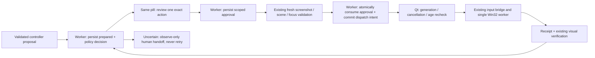
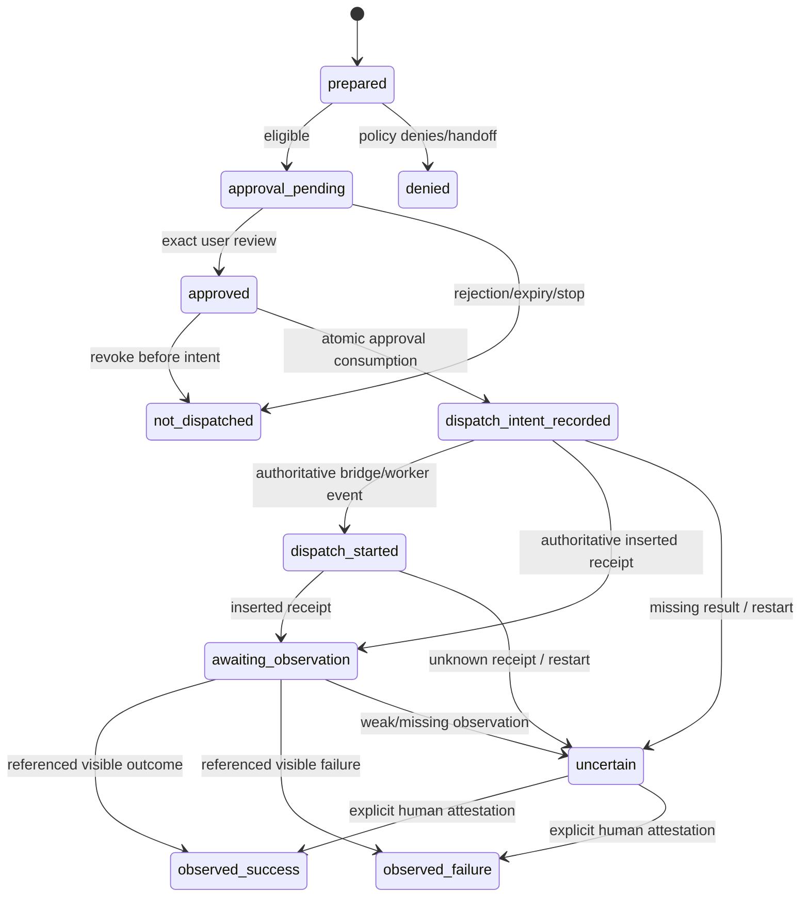

# Monster v3 Phase 3 — effects, permissions and reconciliation

**Implemented; native Windows qualification remains pending.** The supported live
scope is still the opt-in, supervised disposable-editor mission from Phase 2.
External commits and other new workflows are not enabled. The default mission
runner is fake; ordinary standalone supervised behavior is unchanged.

## Architecture and authority

The existing version-1 Effect remains the subtask delegation ledger. Version-2
Effect and Approval records add per-action identity and authorization, in the same
repository, not a second orchestration/input engine. `effects.py` owns the action
projection/journal; `policy.py` owns deterministic classification; the Phase 2
queued bridge carries requests between the Qt controller and the SQLite worker.

SQLite work never blocks Qt. No database transaction waits for a human, model,
screenshot, signal or worker. The input path remains the existing controller →
InputBridge → Windows worker, with original 10/20/300 budgets and independent
Ctrl+Alt+X. A committed dispatch intent is not permission to skip scene freshness,
worker focus/geometry checks, cancellation or cleanup.

The model proposes; deterministic local policy decides eligibility; the human
approves one exact eligible effect. Page text, model risk labels and summaries
cannot create grants. Mission approval and final task confirmation are separate.
The adapter cannot override a denied action. Journal failure before intent commit
means **zero worker input**. Standalone tasks have no injected mission action gate.

## Policy table

| Class | Policy service | Live Phase 3 |
| --- | --- | --- |
| observe_only | Allow only under active consent | Human observation/review; no input |
| local_reversible | Exact supervised review | Fixed scratch text; LEFT/RIGHT/HOME/END; movement |
| local_persistent | Exact review | Blocked; no file-save/settings workflow added |
| external_commit | Fresh, one-use effect approval in simulations | Blocked; no send/submit/publish/account/deploy workflow |
| destructive | Deny | Blocked |
| credential_or_identity | Human handoff | No secret input/vault/model-context flow |
| financial_or_legal | Deny | Blocked |
| unknown | Fail closed | Blocked, including unclassified clicks and Enter |

`scoped_low_risk` is unavailable, even if a caller passes an enabling flag. Missing,
malformed or additional unsupported permission fields are rejected. The only live
text is the exact fixed sentence selected by the existing editor objective catalog;
arbitrary model-generated typing is denied. A low/benign model label never reduces
risk; a sensitive/uncertain label can only escalate. Coordinates cannot establish
that a button is benign. Focus the editor manually rather than approving guesses.

## Identity, fingerprints and review

The version-2 intent binds mission/subtask, parent attempt, generation, workspace,
non-sensitive target/objective references, action kind, original observation,
scene reference, policy version and HMAC of exact action content. The scene
reference covers the existing display/foreground geometry; visual scene equality
is checked by the original screenshot recheck, not inferred from geometry alone.
A new checked observation is required before consumption; changed scope invalidates
the old approval. No website origin or account is read through hidden APIs. Those
unsupported scopes cannot be added by supplying extra fields.

Canonical sorted JSON and standard HMAC-SHA256 fingerprint the action and review.
The key is random and **RAM-only**, never persisted with the journal. Consequently
low-entropy text cannot be guessed using an unkeyed content hash. After restart the
old key is unavailable and old grants are revoked; reconciliation uses references
and human inspection rather than reconstructing content. This deliberately trades
cross-restart content reconstruction for privacy. It is not a credential vault,
encryption-at-rest feature or defense against a compromised local process.

Approvals contain effect ID, fingerprint, policy/workspace/generation, UI request
ID, review digest, expiry, issue/consumption timestamps and `local-user` actor
reference. One-time consumption and dispatch intent are one BEGIN IMMEDIATE
transaction. Two callbacks cannot spend it twice. Target/content/focus/scene/scope
changes invalidate the grant. Refusals and cancellations never create broad grants.

The existing pill shows exact transient action data, target/scope, deterministic
risk, a fingerprint prefix, 60-second expiry and why review is needed. Buttons are
**Approve this exact action**, **Reject**, **Edit / prepare again**, **Pause mission**.
Edit/pause safely stops; preparation of a new proposal needs fresh review. No
approve-all option exists. Normal questions reset the original controls/labels.

## Action lifecycle and evidence

Prepared and initial policy events commit together. A receipt alone cannot produce
observed_success. Evidence carries source, UTC epoch observation time, observation
reference and category. `visual` means model-assisted screenshot evidence, not an
independent remote-service receipt. `human_attested` is never relabeled machine
verification. Human final confirmation plus visual success and cleanup remain
required for ordinary native subtask success.

An uncertain action blocks further action preparation and dispatch in that
workspace, including inside the same subtask. Its journal observation also asks
the controller to stop. Subtask/mission continuation and new real mission startup
are blocked by unresolved actions. A failure may be reconsidered only as a new
proposal with fresh exact review; no input is automatically replayed.

## Startup and human reconciliation

On opening the coordinator, scan the journal before any delegation. Revoke pending
or undispatched approvals; mark intent/started/receipt-without-observation uncertain;
preserve observed success/failure. Phase 2 still revokes outer undispatched grants
and requires fresh mission authorization after reopening. A replayed LangGraph
node cannot consume an old action approval or repeat a dispatched subtask.

Tray → **Mission effects · observe-only review…** lists uncertain effects in the
same pill. No second capture engine or input is used: inspect the desktop yourself.
The card shows action kind, objective/target reference, fingerprint, risk and last
known state. **Confirm occurred**, **Confirm did not occur**, **Leave unresolved**,
or **Abandon mission** record only an attestation or stop. There is no retry button.
If you cannot independently establish the outcome, leave it uncertain. Abandoning
is not proof that an effect did not happen; the uncertainty remains in the journal.

A global review continues across all unresolved missions, not just the latest one.
Storage errors show a fixed error notice and never masquerade as “no unresolved
effects.” Action attestation does not automatically certify all subtask criteria or
restart execution. The existing evidence-based subtask reconciliation API is
separate and refuses unresolved action effects; human-only results retain
`human_attested` provenance. A richer task-level reconciliation workflow is deferred.
Unknown input cleanup quarantines the desktop gate; inspect held input and restart
before further execution. Attesting an outcome never clears that quarantine.

## Storage migration and retention

Ledger schema **2 → 3** is additive and transactionally tested. Existing missions,
subtasks, approvals, events and LangGraph checkpoints remain intact. New tables:
`action_effects` (version-2 projection), `action_approvals`, `effect_audit`. Existing
subtask events seed the audit with `legacy_v1` provenance. Subsequent subtask events
also append. Database triggers reject audit UPDATE and DELETE. Projections change
only via the service; immutable intent fields are preserved. SQL ownership is not
a sandbox against malicious local administrators.

Before upgrading, stop Monster and make a private backup of the entire mission
state directory, including any WAL files, or use SQLite's backup API while offline.
Restore that complete backup for a binary/schema rollback; an older binary must
not open schema 3. Future unsupported schemas fail closed. Migration DDL and version
updates share an explicit transaction; failure rolls back without a half-upgrade.

Normal pruning cannot remove unresolved action missions. Immutable audit and
per-action records remain for reconciliation even when old resolved graph/subtask
metadata is pruned. There is no automatic destructive audit pruning in this phase;
archive/rotate a fully reviewed offline store under operator control if needed.
SQLite is not encrypted: use private local permissions and encrypted user storage.

## Privacy and remaining qualification

No instruction/message bodies, credentials, screenshot bytes, raw model reasoning
or HMAC keys enter the journal/checkpoints. IDs must also be non-sensitive; do not
encode a secret in an ID. Mission RunDiagnostics is now content-free at the source,
including provider callbacks, and retains no PNGs. Denied proposals are not echoed
back into model history. Standalone reports retain their existing explicit export
behavior. The exact approval preview is transient UI data, not a persistent body.

This is not a general secret detector for arbitrary visible desktops. Keep secrets
out of the designated disposable test workspace; existing capture/model consent
still applies. Authentication requires manual handoff, not model-driven secret
entry. No provider switching or screenshot egress consent is granted by an effect
approval. Live Windows/model accuracy, focus/scene behavior and stop latency remain
unqualified; see [Phase 3 qualification](PHASE3_QUALIFICATION.md).
