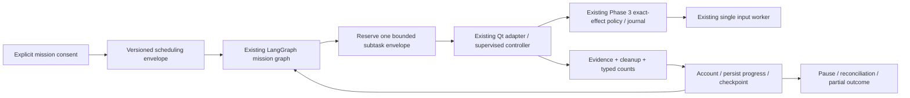

# v3 Phase 4 — bounded long-horizon scheduling

**Implemented as a portable scheduling milestone. Native qualification: PENDING.**
The new live pilot is disabled by default and requires explicit reviewed Phase 2/3
qualification metadata. This does not enable unrestricted or unattended input.
Existing two-part experimental missions and standalone modes retain their policies.

## Baseline and architecture

Started at348ce7c with Phases 1–3 present: strict contracts, persistent LangGraph,
SQLite journal, Qt-safe adapter, one desktop writer, independent stop and exact
per-action review. Baseline **631 passed, 3 skipped in81.16s**. Phase 2/3 Windows
qualification remains pending; their status has not been upgraded by simulation.



No second graph, model provider, cursor owner, screenshot engine, queue broker or
agent framework was added. New modules are `scheduling.py`, `plan_templates.py`,
`recovery.py`, `reports.py` and the explicit simulation CLI `pilot.py`.

The v1 Mission/Subtask contract and existing statuses remain. A separate strict
`ScheduledPlan` binds that mission to a reviewed catalog digest, provider/model
configuration fingerprint, mode and `MissionBudget`. `MissionConsent` binds the
exact plan digest, workspace, generation, policy, expiry, model/egress scope and
human-supervision requirement. A plan/catalog/scope change invalidates admission.
This is trusted operator consent, never model-created authority.

Six deterministic objectives (`pilot-a`…`pilot-f`) append fixed harmless sections
in a disposable editor. Dependencies determine eligibility; independent desktop
nodes are still serial. Old catalog entries remain unchanged. New pilot text
cannot run through a legacy request lacking an admitted scheduling reference.
No arbitrary generated text, Enter, unclassified clicks or external workflow is
allowlisted. On real tasks, the final visible-result review must include checking
that prior sections were preserved, not merely seeing the last marker.

## Resource envelopes

| Resource | Default | Hard ceiling |
| --- | ---: | ---: |
| Wall duration | 3600s | 7200s |
| Active duration | 1200s | 3600s |
| Subtask starts | 12 (six planned stages) | 12 |
| Input transactions | 40 | 120 |
| Planning calls | 80 | 240 |
| Accepted review responses | 256 | 1024 |
| Progress checks | 512 | 2048 |
| Consecutive no-progress outcomes | 2 | 2 |
| Ambiguous-effect automatic retries | 0 | 0 |
| Concurrent real desktop subtasks | 1 | 1 |

Every GUI subtask retains the original **10 actions / 20 planning calls / 300s**.
The aggregate model budget means the same planning calls counted by the current
controller, not every compatibility/verification HTTP operation. Those additional
operations remain inside the existing subtask time and safety envelope.

Before delegation the scheduler durably reserves the full subtask action/planning
caps, 64 review responses and a 310-second active allowance (300s plus cleanup
grace). Native scheduled controllers reject accepted responses beyond that review
allowance; this does not change standalone review behavior. A reservation is unique
to the subtask effect and mission generation, with no transaction held across input.

After a trustworthy result and cleanup, unused reservation is released and actual
reported counts retained. Unknown input/cleanup keeps the conservative charge.
Known consumed counters are monotonic; charged capacity includes in-flight
reservations and may decrease when unused capacity is released. This is intentionally
more conservative than per-input billing: a mission may stop before using every
nominal remaining action if a whole next subtask envelope no longer fits.

Reservations survive a crash without refund or double charging. UTC deadlines and
last-seen time are durable; monotonic time measures active in-process duration.
Paused/consent-wait time does not extend the original wall deadline. Clock rollback
pauses with timing_uncertain. A measured cap overrun is recorded and blocks further
stages; it is not discarded as an exception followed by successful completion.
OS stalls/power transitions cannot provide a hard real-time preemption guarantee.

## Outer autonomy, inner approvals

One exact mission consent authorizes sequence selection within the admitted DAG.
After a verified subtask, cleanup, accounting and checkpoint, the next eligible
stage proceeds without another outer subtask prompt. **Each native action still
needs the Phase 3 exact-effect review and fresh scene checks**, and each subtask
needs the existing final human visible-result confirmation. Mission consent cannot
approve a Send, external commit, credential, destructive or financial action.

Consent review shows the six fixed stages, plan digest, resource maxima/used input,
workspace, screenshot/provider scope and stop behavior. Simulation explicitly says
no desktop input/model requests. The plan and current provider configuration must
match on every transition and before applying a real action gate reply. No silent
fallback or provider switch exists.

## Recovery, pause and restart

- **Pause after stage:** latches durably before awaiting snapshot I/O. The current
  authorized bounded subtask may finish; no following stage starts. Once idle,
  revoke consent and advance generation. The UI must not use this as emergency stop.
- **Immediate stop/takeover:** retains the existing independent stop/cancellation
  path. Pending native handoffs are latched invalid and uncertain input quarantined.
  Ctrl+Alt+P retains its immediate controller-stop semantics; the new boundary pause
  is a separate tray/pill control.
- **Resume:** explicit user action, fresh plan/provider/consent validation, new
  generation and existing GUI scene/foreground/lease preflight. Completed stages
  are skipped; counters and deadlines do not reset. No mission auto-runs on launch.
- **Uncertain input/delegation:** use the Phase 3 journal and human reconciliation;
  never replay by changing the effect ID. Attestation keeps human provenance.
- **Pure pre-dispatch retry:** deterministic simulation preflight can retry a
  provably input-free transient fault with capped exponential jittered backoff.
  Two consecutive no-progress failures stop even if retry configuration permits
  three. Retry overhead is charged against the same subtask planning cap **before**
  runner handoff. Real GUI subtasks are never automatically retried: the current
  native adapter cannot establish an independently qualified pure planning seam.
- **Wrong target, stale scene, policy/storage failure:** pause/partial with a safe
  category. Do not guess a new target, delete uncertainty or switch models.

This implementation deliberately prefers a false-negative pause to a duplicated
side effect. The existing anti-loop controller remains responsible for action-level
stalls; outer progress counts only evidence-bearing successes and cleanup.

## Durable state and bounded context

Ledger schema **3 → 4** adds `mission_schedules`, `mission_reservations` and bounded
`mission_progress` snapshots to the same repository. Migration is additive and
atomic. Existing missions, effects, approvals, immutable audit events and LangGraph
checkpoints remain. Checkpoint state version1 is unchanged because the scheduling
envelope is separate and old graph fields retain their meanings.

At most 64 recent progress snapshots per mission hold IDs, provenance and counters;
older outcome/audit evidence remains in the existing journal. Pruning resolved
mission metadata also removes its scheduling projections; unresolved effects are
protected. No raw screenshot, action script, body text, credential or reasoning is
copied into schedule, progress or report records. Current observations and bounded
subtask context remain ephemeral in the existing engine; no history concatenation,
vector store or background workflow learning was added.

Back up the private state directory with Monster stopped, including WAL files, or
use SQLite's backup API. Roll back by restoring the full backup alongside the old
binary; old binaries must not open schema4. Unsupported schemas fail closed and
are never silently reset. SQLite is still not encrypted; use private/encrypted
local storage. See prior Phase 3 privacy and archive guidance.

## Operator UI and simulation commands

The existing tray now offers six-stage simulation, observe-only rehearsal, qualified
native pilot, requested mission progress, boundary pause and explicit resume.
Progress reuses the same pill: verified/remaining stages, charged active/input/model
budgets and Pause/Stop/Resume/Close controls. It never replaces a pending safety
review. There is no permanent dashboard, second character or spinning indicator.
All widgets remain on Qt; SQLite/graph work stays on the existing async worker.

Default GUI demo and two-stage native entry remain available. To run an offline
fixture, with **zero desktop input**, from the repository root:

```powershell
uv sync --frozen
uv run python -m monster.mission.pilot --directory .monster-missions --scenario success --approve-simulation
uv run python -m monster.mission.pilot --directory .monster-missions --scenario pause_restart --approve-simulation
uv run python -m monster.mission.pilot --directory .monster-missions --scenario pure_timeout --approve-simulation
uv run python -m monster.mission.pilot --directory .monster-missions --scenario ambiguous --approve-simulation
uv run python -m monster.mission.pilot --directory .monster-missions --scenario budget --approve-simulation
uv run python -m monster.mission.pilot --directory .monster-missions --scenario observe_only --approve-simulation
```

The explicit flag approves only that known synthetic scenario, including its restart
review. It cannot select a real runner. JSON labels simulation and fake evidence;
success/pause_restart/pure_timeout complete six fake stages, ambiguous remains
paused without replay, budget returns partial, and observe_only delegates nothing.

Reports include plan digest, generation, fixture/source fingerprint, statuses and
evidence provenance, consumed/charged counters, unresolved effects and safe reason.
Fake results are never native measurements. Active progress timings are labeled
conservative budget charge, not model benchmarks. Unmeasured median provider/
capture/input latency, GPU/DPI, model digest and native duplicate counters stay null.
Known human-intervention counts are lower bounds when a failed result lacks counts.

## Actual verification and limits

Mandatory baseline631 passed/3 skipped; first full integrated run648 passed/3 skipped.
After accounting/pause/restart tests, a full run passed662 tests/3 skipped in96.07s.
The final informed-consent UI regression and release count are recorded in
[Windows Phase 4 qualification](WINDOWS_PHASE4_QUALIFICATION.md).

Independent review reproduced model-cap under-accounting for a stricter subtask
with a pure retry. Regression tests now prove no handoff after that cap is consumed
and persist measured overflow rather than leaving successful-looking accounting.
A controlled snapshot barrier also reproduced the boundary-pause race; the durable
flag now precedes its first await. Two no-progress outcomes always stop.

Native Phases 2/3/4 remain **PENDING**. No LAN endpoint, real keyboard/mouse or actual
Windows foreground behavior was tested here. The native pilot is gated by an
operator-provided `NativePilotQualification` binding PASS evidence references for
Phases2/3, reviewed source revision, workspace, provider configuration and expiry.
It is a local operator attestation, not cryptographic proof or generated evidence.
No PASS record is created by tests, startup or simulation. Do not edit a qualified
checkout mid-run; inspect the reported source fingerprint as well as its commit.

Phase5 proposal: structured strategic planning and adaptive reasoning restricted to
an admitted objective catalog, with bounded context and measured improvements. No
new input permissions, unattended execution, external commitments, provider fallback
or virtual workspace is implied by that later work.
