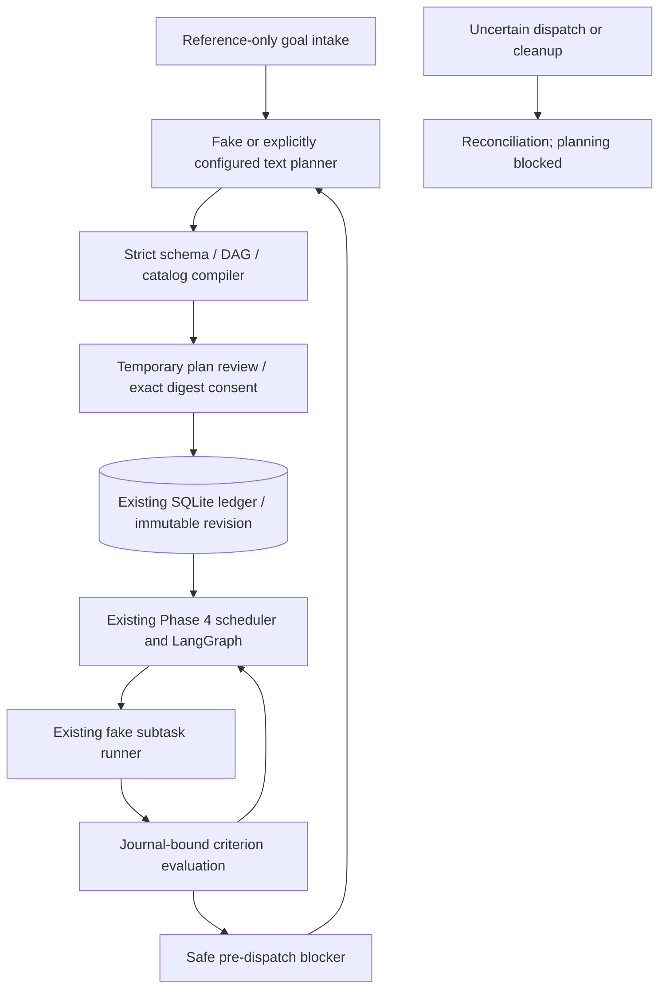

# Phase 5 strategic intelligence

Portable, simulation-only implementation. Native qualification is **PENDING**.
This layer does not fix the operational model's Windows grounding or uncertain
visual verification. It cannot make an unverified action successful.

## Prerequisite audit

Implementation began on branch `work`, HEAD
`338ee94d5aed9262a5b9a0123a66e88783065a8a`. The existing uncommitted Ctrl+N and
shortcut-consistency fix was retained. No repository AGENTS.md was present.
Python 3.12.14 and the existing frozen uv lock were used; no dependency was added.

| Prerequisite | Inspected implementation | Result |
| --- | --- | --- |
| Phase 1 | `contracts.py`, `repository.py`, `graph.py`, `runner.py`, SQLite LangGraph checkpoints | Present |
| Phase 2 | `workspace.py`, `gui_bridge.py`, `gui_subtask_adapter.py`, `runtime.py`, independent worker stop | Present |
| Phase 3 | `effects.py`, `policy.py`, `reconciliation.py`, controller intent/approval handshake | Present |
| Phase 4 | `scheduling.py`, `recovery.py`, `plan_templates.py`, six-stage pilot, restart/scheduling tests | Present |
| Baseline | `QT_QPA_PLATFORM=offscreen uv run --frozen pytest -q` | 667 passed, 3 skipped, 96.44s |
| Windows Phases 2–4 | Existing qualification documents | PENDING |

## Boundaries and ownership



There is no second scheduler or input path. The existing graph retains
lease/deadline checks, reservations, effect IDs, stop/cancellation and checkpoints.
`MissionNodes.assess` evaluates meaningful outcomes; `complete` additionally
requires the strategic evidence rubric. `MissionScheduler.guard` checks that the
active strategic revision matches the scheduled spec before delegation.

Planning and human review run outside graph execution, with no database
transaction held across either. This keeps the ledger authoritative when graph
checkpoints lag. After admission or revision commit, graph execution starts or
continues only through the existing coordinator and scheduler consent boundary.

## Contracts and catalog

`mission/strategic/contracts.py` defines versioned strict contracts for goals,
criteria, objectives, proposals, admitted revisions, revision proposals, model
roles, consent, limits, evaluations and metadata-only planner call records.
Unknown fields and future versions fail closed. Objective and criterion tuples
are frozen. Scheduled specs use the existing Phase 4 contract; persisted JSON and
canonical digests, rather than mutable Python object identity, are authoritative.

The application-owned simulation catalog has six stages:

1. Identify requirements.
2. Draft architecture outline.
3. Describe tradeoffs (one alternative structured-rubric strategy is available).
4. Describe validation.
5. Review completeness.
6. Present the evidenced summary.

These are **synthetic outcomes**, not real document contents. A successful fixture
run writes no design proposal and performs no native input. Natural-language
intake recognizes the small documented “prepare/draft/create a short technical
design proposal” family; unknown outcomes or constraints require clarification.
The goal and success rubric appear in review. Arbitrary application work, account
operations, code, coordinates, tool payloads, selectors, provider instructions and
unrecognized objective kinds are not executable strategies.

The typed API also permits explicitly declared unsupported/needs-user criterion
gaps. Every criterion must be covered by a compatible catalog objective or an
explicit gap. A plan cannot silently discard a required criterion. Goal scope is
simulation-desktop/simulation-editor; external effects, credentials and native
input remain excluded. Broader interpretation is deliberately not inferred from
the fixture adapter.

## Consent and revisions

A candidate is not admitted merely because it has a valid schema. Plan review
binds its canonical digest, revision ID, epoch and absolute expiry. Admission
atomically inserts the revision and consent, mission specification and scheduling
envelope in the existing ledger. Initial graph failure cannot lose that record.
A second scheduler consent starts the actual simulation, binding the exact
sequence, generation, budget and provider configuration. Neither is native action
approval.

A pending revision blocks execution. The initial revision and all ancestors remain
append-only. This milestone conservatively supports one pending strategy
substitution at a recorded pre-dispatch blocker; it does not expose arbitrary DAG
editing in the UI. The replacement must retain the objective's stable ID, scope,
dependencies and criterion bindings. Completed objectives, attempted side effects,
criteria, model routes, deadline and budgets cannot be rewritten. Renaming an
objective to retry or proposing an earlier strategy again is rejected.

Default limits are two replan attempts, one attempt per blocker, six strategic
calls, twelve objective nodes, depth eight, width six and twenty-four edges.
Hard ceilings are three replans/eight calls, depth/width twelve and thirty-two
edges. Responses, context, token settings, timeouts and JSON nesting are bounded.
Up to 128 strategic sessions may be retained in one ledger. Calls and replan attempts are reserved durably before inference and remain charged
on failure/cancellation. Post-admission calls also consume Phase 4's global model
budget. Budget/no-progress exhaustion forbids more strategic calls.

The graph records proof that a preflight failed before dispatch, with zero input
and confirmed cleanup. Only that proof permits a revision. Any uncertain subtask,
uncertain action journal effect, active reservation or unknown cleanup blocks
strategic calls. Two genuinely failed preflights still exhaust Phase 4's
no-progress limit. The implementation corrects an existing double count between
`note_failure` and settling the *same* pure-preflight failure; it does not reset
counters during a revision.

## Evidence, context and restart

Criterion evaluation joins the admitted coverage map to the existing effect and
typed result records. Missing proof or a worker receipt alone is uncertain;
verified failure is contradicted. Fake proof cannot meet a visual criterion.
Explicit human attestation retains its provenance and requires its observation,
human confirmation and cleanup. Native visual predicates remain unsupported in
this simulation-only layer. Multiple outcomes cannot hide a contradiction.

Every required criterion must be satisfied, every scheduled objective must have a
resolved successful outcome, and no effect/cleanup ambiguity may remain before
completion. Optional gaps permit `completed_with_optional_gaps` only when the
original goal explicitly allows them. A semantic model assessment is advisory;
invented evidence IDs or model-only completion claims are rejected and never
update journal truth.

Mission context contains goal/criterion refs, active revision digest, evidence
refs, configuration identity and monotonic usage. Objective context consists of
the active catalog objective, dependency outcomes and preflight blocker proof.
GUI action context remains entirely inside the existing controller; strategic
code receives no screenshot or coordinate history.

On restart, pending reviews and late response epochs are invalidated and scheduler
consent is revoked. Validated admitted history and verified effects reconstruct
progress. A commit before the first checkpoint recovers a complete initial graph
state. Verified effects are skipped, never replayed. An uncertain dispatch stays
uncertain. Required private context is RAM-only; if absent after restart the
scheduler pauses with `private_context_required` instead of inventing it.

## Persistence and rollback

Ledger schema 5 additively creates `strategic_sessions`, `strategic_revisions`,
`strategic_calls`, `strategic_blockers` and `strategic_evaluations`. Existing
missions, effects, approvals, reservations and LangGraph checkpoints are retained.
Migration occurs in the existing explicit DDL transaction. Unknown future schemas
are rejected without resetting storage. Evaluation retention is sixteen records
per mission; call and revision history are bounded by hard budgets. Existing
terminal-mission retention also deletes the associated strategic records.

Before upgrading a real state directory, stop Monster and back up the entire
private directory, including checkpoint and ledger WAL files, or use SQLite's
backup API with no mission running. Restore the whole consistent pre-upgrade
backup to roll back; do not open schema 5 with older code or decrement the schema
version by hand. Migration/backup preservation is exercised by tests.

## Running and review

From the repository root (Linux tests additionally use `QT_QPA_PLATFORM=offscreen`):

```text
uv sync --frozen
uv run python -m monster.mission.strategic.pilot --directory .monster-missions --scenario replan_restart --approve-simulation
```

Use a fresh directory for reproducible pilot results. Explicit simulation consent
covers the fixed fixture, its reviewed alternative and restart consent. The
report must say simulated, six verified stages, one revision, no remaining work,
and zero native input. It includes criterion-level evidence and planner metadata.

Tray → **Phase 5 · plan and simulate…** accepts the supported fixture goal and
opens a temporary readable plan review. Approve/Simulate proceeds to exact
scheduler consent. Edit goal cancels so a fresh goal may be submitted. Cancel,
Stop and manual takeover invalidate pending authority. The six-stage **safe
replan simulation** injects a pre-dispatch blocker after two outcomes; choose
**review safe revision…**, review the changed plan and consent to continue.
**Resume simulation…** reconstructs the latest admitted strategic mission.

Mission progress shows verified/remaining stages, usage, revision count and
synthetic evidence provenance. No permanent dashboard or live dynamic planning
is introduced; default supervised behavior stays intact.

## Targeted Phase 6 proposal (not implemented)

Add a workspace-isolation capability behind an explicit platform adapter. Bind
workspace identity and desktop/session generation into plan, lease, consent and
effect fingerprints; require native qualification for isolation, capture, focus,
stop and quarantine. Start with a disposable local-editor workspace and deny
cross-workspace replay. Do not add arbitrary sites, account automation or external
commit permissions as part of isolation. Validate these independently of planner
quality before broadening the objective catalog.
